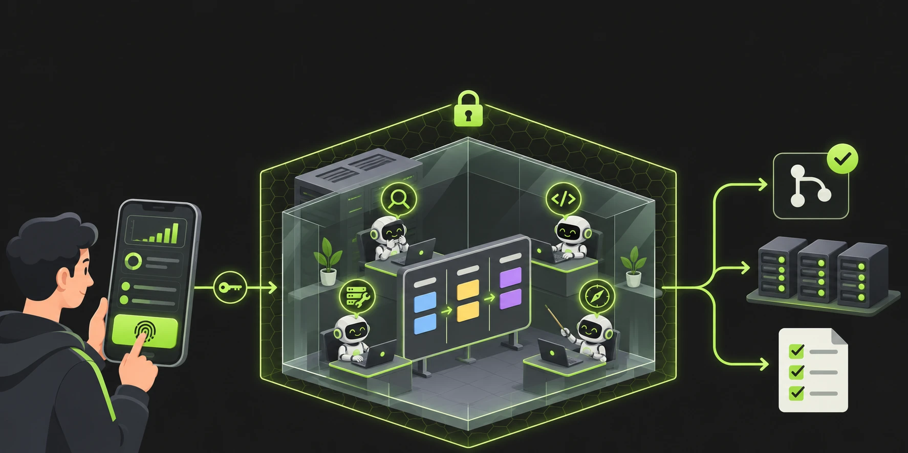
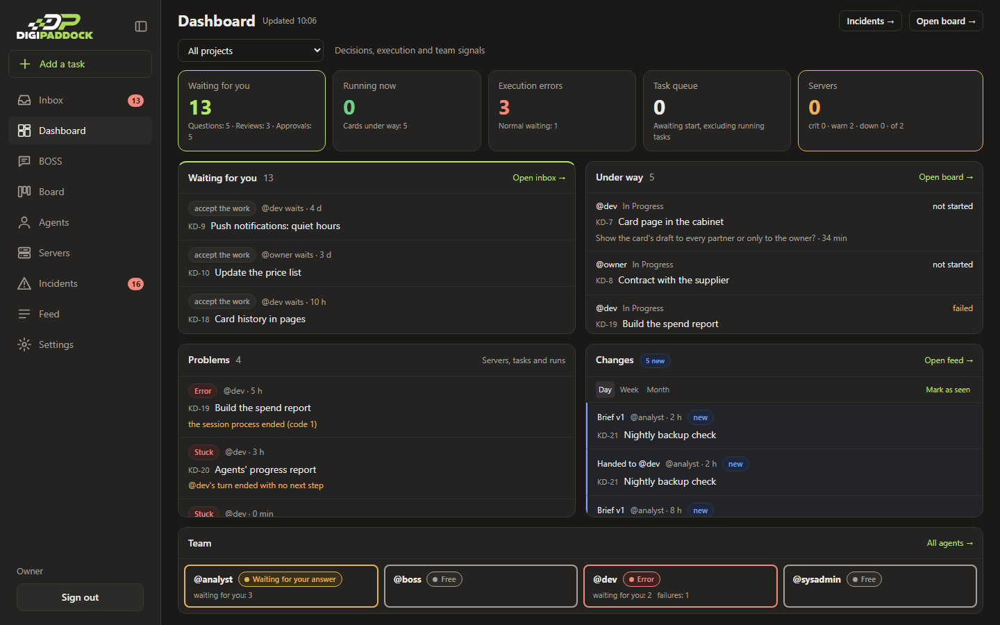
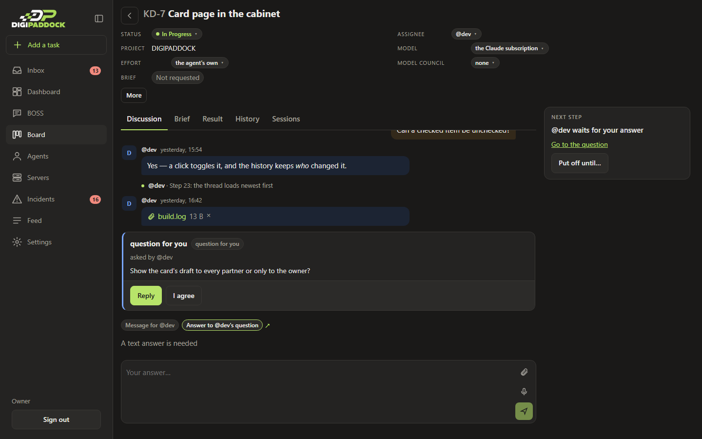
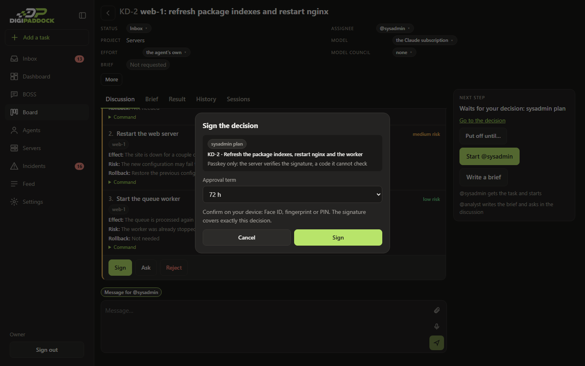
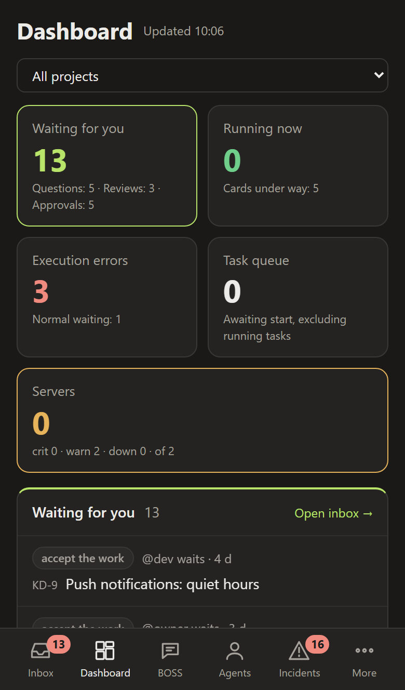
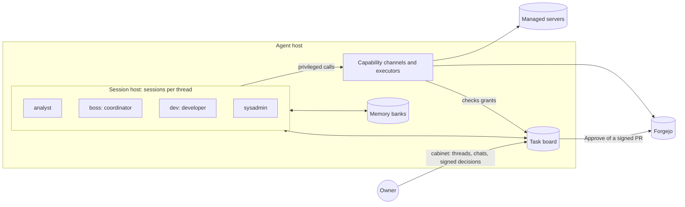
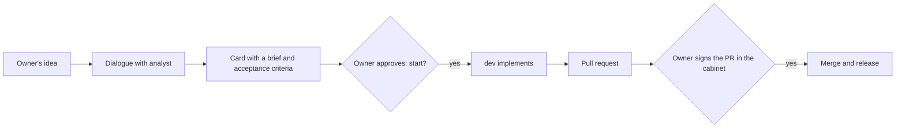

# DigiPaddock



A factory for long-running AI agents of predefined types on one Linux host.

Each agent is a Claude Code session with its own Linux user, its own chat in the owner's cabinet, its own memory and a narrow set of powers taken from a finite capability registry. A new agent type is a manifest (`agent.json`) and instructions. It needs no new code as long as every power it needs already exists in the registry.

The factory is assembled from existing components rather than written from scratch:

| Component | Role in the factory |
|---|---|
| [Claude Code](https://code.claude.com) | The agent runtime: one session per agent and thread (a card's thread or the agent's chat) |
| SQLite | The task board and the owner's web cabinet: one small service of the factory owns the database; every piece of work is a card, every agent's turn runs in a card's thread or the agent's chat |
| [Telegram](https://core.telegram.org/bots) | Optional: a plain-text duplicate of critical alerts to the owner's phone; every other message of the factory is in the cabinet |
| [Hindsight](https://github.com/vectorize-io/hindsight) | Long-term memory banks for agents |
| [Forgejo](https://forgejo.org) | Code hosting and review: the owner approves pull requests with a signature in the cabinet, or there |



<table>
  <tr>
    <td width="40%"></td>
    <td width="40%"></td>
    <td width="20%"></td>
  </tr>
  <tr>
    <td>Every piece of work is a card; agents answer and ask in its thread</td>
    <td>Risky steps are decisions signed with the owner's passkey</td>
    <td>A PWA with push and voice</td>
  </tr>
</table>

**[Try the cabinet](#try-the-cabinet)** · **[Features](docs/features.md)** · **[Contributing](CONTRIBUTING.md)**

## Why

Agents that do real work (operating servers, developing code) need more than a chat window:

- **Where does work come from, and where does its state live?** A shared task board. A card describes the work; agents claim cards and report on them.
- **How does a person stay in control without approving every command?** The owner approves tasks and the few most dangerous actions. Approvals are decisions in the card's thread, signed with the owner's passkey and recorded by the cabinet service where the agents cannot write, not by the model.
- **What stops an agent from doing what it must not, even after a prompt injection?** Limits that do not depend on the model obeying a prompt: separate Linux users, an OS sandbox, capability channels with permission files, and executors that check every call.
- **How do agents survive restarts?** Commits, card notes, a notes file and a memory bank.
- **How do agents work as a team?** A coordinator agent routes cards, watches for stalled work, passes handoffs between agents and gives directives.

## At a glance



## The team

| Agent | Status | What it does |
|---|---|---|
| **analyst** | running | Read-only analysis. First: clarifies a task with the owner in a dialogue and writes a brief with acceptance criteria into the card before anyone implements it; the owner's approval in the cabinet approves that brief version and starts the work; a large brief is written as stages, and the same approval creates one child card per stage under an aggregate parent. Later: data, UX and marketing research |
| **boss** | running | Coordinator: routes cards, watches for stalled work, passes handoffs, gives directives, splits a goal the owner allowed it to split. Approves nothing |
| **dev** | running | Implements cards in its own clone and opens pull requests. Merges and releases only after the owner approves the pull request (a signature in the cabinet, or Approve in Forgejo) |
| **sysadmin** | running | Watches the server fleet, reads through a read-only gateway, changes servers under an approved plan, with rule-based approval for eligible test-environment steps |
| **workers** | running | Short-lived sessions that run one specialization (implementer, reviewer, tester, docs and so on) for one card in a prepared slot, at the coordinator's request; the current configuration has two developer slots |

Agents differ by their powers. Kinds of work (copywriting, test writing, UX review, release checks) are specializations of an existing agent type, not new agents. See [docs/team-model.md](docs/team-model.md) for the model and [docs/roles.md](docs/roles.md) for who does what and the flows between them.

## How work flows



A large brief runs as stages under the same one approval. When every stage is one agent's work in one project, the stages run as a chain: one after another on one branch and pull request per repository, each read by a code reviewer and passed, returned or held by the coordinator. The owner is asked only when a stage is held, and decides once at the end. See [long work in stages](docs/features.md#long-work-in-stages).

For server work, the sysadmin proposes a plan on a card. The cabinet automatically approves plans made entirely of catalogued operations in designated test environments. The owner signs all other plans in the card thread. Critical actions require a separate approval of the exact command. See the [security model](docs/security-model.md#boundaries-and-what-holds-them).

## Status

- Runs in its first deployment: a small company's server fleet and code repositories, with the sysadmin, developer, coordinator and analyst agents.
- An idea, not yet planned: Codex as an alternative agent engine.
- The [Ubuntu 24.04 installation guide](docs/install.md) covers the bootstrap script and its prerequisites. The bootstrap has run on the first deployment's existing host. A full installation on a fresh host remains unverified.

## Try the cabinet

Use the Python environment from [Local development and tests](#local-development-and-tests). From a fresh clone, build the web app and start the seeded cabinet:

```bash
npm --prefix common/cabinet/web ci
npm --prefix common/cabinet/web run build
python -I common/bin/kd-cabinet serve --dev --seed
```

Open [the local sign-in page](http://localhost:8765/login), use one of the one-time codes printed for `owner` or `anna`, and register a passkey. A browser with a virtual authenticator works too.

The development cabinet uses local state under `tmp/cabinet-dev/`, synthetic cards and servers, and scripted agent replies. It needs no Claude credentials, Forgejo instance, or access to managed servers.

## Local development and tests

Use a disposable Linux development environment as an ordinary user. The reference environment is Ubuntu 24.04 on x86-64 with Python 3.12, Git, Bash, and the Python `venv` module. The web checks also need Node.js 22.22.2 or newer in the 22.x line and npm. Run the following commands from the repository root after cloning it:

```bash
python3.12 -m venv .venv
source .venv/bin/activate
python -m pip install -r requirements-dev.txt
python -m pip install --require-hashes -r common/cabinet/requirements-build.txt
python -m pip install --require-hashes --no-build-isolation -r common/cabinet/requirements.txt
```

The cabinet dependencies are installed separately because their lock files use hashes; the development tools have a separate requirements file. The cabinet lock targets Python 3.12 on Linux x86-64. Installing these packages downloads dependencies, but does not install the factory, start its agents, or configure a deployment. The tests use fixtures and temporary state; they do not need deployment credentials, a running agent, Forgejo, Hindsight, or access to managed servers. Some tests start local processes or local sockets. Use Linux for the full suite: Windows can run a subset, but cannot validate Linux permissions, `flock`, Unix sockets, or sandbox behavior. Review skip reasons in the test output; a skipped Linux check is not evidence that its behavior works.

Select checks by the [change/risk policy](docs/testing.md); the full suite is an explicit Linux regression, not the default after every edit. Logs and a short JSON report go to `tmp/checks/`:

```bash
python scripts/check.py --profile focused --test tests/test_check.py
python scripts/check.py --profile static --base HEAD
python scripts/check.py --profile frontend --web-test src/lib/stores/cards.test.ts
# Explicit full Python regression when the change/risk policy requires it:
python scripts/check.py --profile full --workers 4 --scratch-root /tmp --base HEAD
```

To repeat GitHub CI locally, install the packages above and the web's (`npm ci --prefix common/cabinet/web`), then on Linux run `python scripts/check.py --profile ci --base origin/main --workers 4 --scratch-root /tmp` — the workflow's command, with the base it would use for a pull request; the scratch directory under `/tmp` keeps the tests' socket paths within the Unix limit ([GitHub CI](docs/testing.md#github-ci)).

Run the web checks separately:

```bash
npm --prefix common/cabinet/web ci
npm --prefix common/cabinet/web run check
npm --prefix common/cabinet/web test
npm --prefix common/cabinet/web run build
```

Optional browser tests use Chromium and two seeded development cabinets on local ports 8765 and 8766. With the same Python environment active:

```bash
export KD_PYTHON="$VIRTUAL_ENV/bin/python"
npm --prefix common/cabinet/web exec -- playwright install chromium
npm --prefix common/cabinet/web run e2e
```

Chromium also needs its operating-system libraries; provision those in the disposable development environment if Playwright reports missing dependencies. Browser tests reset their own state under `tmp/cabinet-dev/`. Do not point them at a deployed cabinet.

For changed code, also run `python scripts/check_changed.py --base HEAD` before committing. After committing, use the commit before your changes as `--base`. See [CONTRIBUTING.md](CONTRIBUTING.md) and the [engineering standards](docs/engineering-standards.md) for the review and verification rules.

## Installation and deployment

Installation is a separate, explicitly authorized operation. Do not run `common/install/` or agent setup scripts merely to try the tests: they configure Linux accounts, permissions, systemd services, network access, and approval boundaries. A deployment needs its own configuration, credentials, review, and owner approval. A push or a passing local test run does not authorize installation, merge, or release.

[docs/install.md](docs/install.md) walks through a new host: the manual steps in the forge and DNS, then `common/install/bootstrap.sh`, which runs the installers in order, checks before every install and stops where a step is the owner's.

A deployment is this repository plus its own private **overlay** repository: host values (`host/host.json`), the server inventory, the private scanner's literal list and the few other files [docs/deployment-overlay.md](docs/deployment-overlay.md) lists; the repository ships an `*.example.*` file for each. Both live on the deployment's forge; the release service builds every release from `main` of the pair and is the only way code reaches the host ([architecture: repositories](docs/architecture.md#repositories-code-and-deployment-overlay)). Values of a deployment never enter this repository.

GitHub hosts the public source and contribution entry point. Forgejo is the source of working history and the deployment workflow. See the [publication checks](docs/engineering-standards.md#github-publication-gate).

## Repository layout

| Path | What |
|---|---|
| `common/` | The shared platform: installers, systemd units, the board and coordination tools, capability channels, memory client, Python package `common/kd/` |
| `common/agent-capabilities/`, `common/agent-profiles/`, `common/agent-sandboxes/`, `common/agent-resources.json` | The finite registries an agent manifest selects from |
| `common/agent-template/` | Instructions shared by every agent |
| `common/coordination/` | Root-owned catalogs of coordination: stall-detector rules, delegation limits, help (assist), diagnostics, host reads, the factory's operations, model providers, the pipeline's mode. Project routing lives in the cabinet's projects table |
| `common/specializations/` | The specialization registry: versioned texts per agent type, read as playbooks by persistent agents and as prompts by workers, plus skills |
| `common/worker/` | Worker slot registry |
| `agents/<name>/` | One agent type: `agent.json`, `CLAUDE.md`, playbooks, and code only for modules the registry does not have yet |
| `host/*.example.json`, `agents/sysadmin/*.example.*` | Example overlay files: the shape a deployment fills in |
| `docs/` | This documentation; `docs/adr/` holds architecture decisions |
| `scripts/` | Development checks and probes |
| `tests/` | Tests of the development checks and of the shell scripts' syntax |

## Documentation

- [Features, with screenshots](docs/features.md)
- [Overview: goals, principles, roadmap](docs/overview.md)
- [Glossary](docs/glossary.md)
- [Architecture](docs/architecture.md)
- [Team model: agent types and specializations](docs/team-model.md)
- [Skills and specializations: source files, catalog and loading](docs/skills-and-specializations.md)
- [Roles and flows](docs/roles.md)
- [Cabinet: screens, decisions, projects, servers](docs/cabinet.md)
- [Cabinet command line: every `kd-cabinet` command](docs/cabinet-cli.md)
- [Security model](docs/security-model.md)
- [Installing a host](docs/install.md)
- [Deployment overlay](docs/deployment-overlay.md)
- [New agent checklist](docs/agents/new-agent-checklist.md)
- [Engineering standards](docs/engineering-standards.md)

## Requirements

- One Linux host with systemd (tested on Ubuntu 24.04), Python 3.12, `bubblewrap` and `socat` for the sandbox.
- A Claude Code subscription. One `claude setup-token` token of it signs in every agent for a year.
- A Forgejo instance. The memory service (Hindsight, with PostgreSQL 18 and pgvector) and Node.js 22 for the cabinet's web go on the same host; the board itself is a SQLite database owned by the factory's own service.
- On managed servers: Python 3.6 or newer for the read-only gateway.

## License

Unless a file carries a separate license notice, DigiPaddock's original code and documentation are licensed under the **GNU Affero General Public License, version 3 only** (`AGPL-3.0-only`). See [LICENSE](LICENSE) for the full terms. Third-party components and external tools retain their own licenses.

DigiPaddock is free software: you can redistribute it and/or modify it under the terms of the GNU Affero General Public License as published by the Free Software Foundation, version 3 of the License.

DigiPaddock is distributed in the hope that it will be useful, but **WITHOUT ANY WARRANTY**; without even the implied warranty of **MERCHANTABILITY or FITNESS FOR A PARTICULAR PURPOSE**. See the GNU Affero General Public License for more details.

Commercial use is permitted under the license's conditions. Distribution of covered versions carries source-code obligations. If you modify the program and let users interact with that version remotely over a network, section 13 requires prominently offering those users access to its Corresponding Source at no charge. Consult the license for the precise scope and requirements.

For security reports, follow [SECURITY.md](SECURITY.md); do not put credentials or vulnerability details in a public issue.
