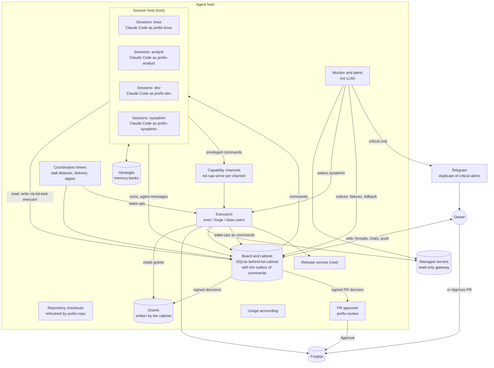
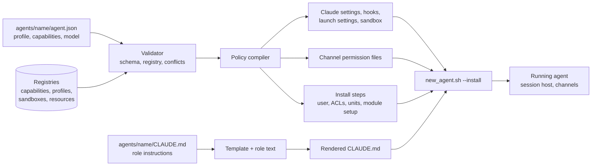
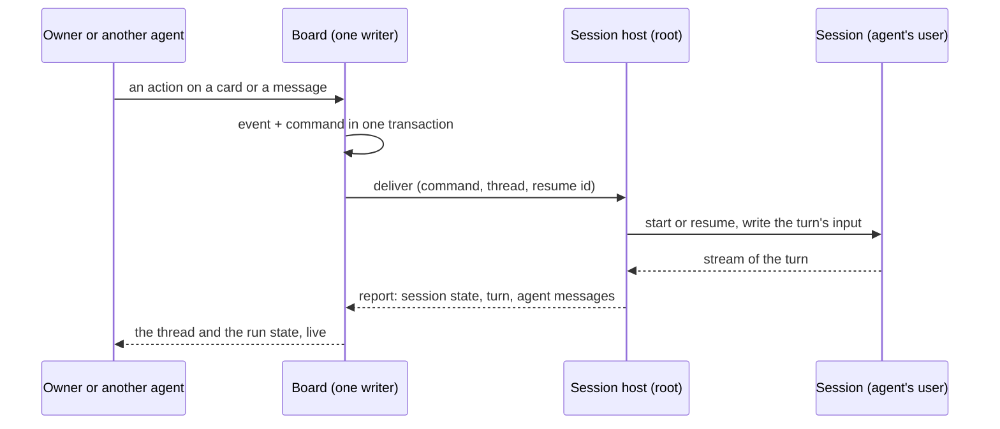
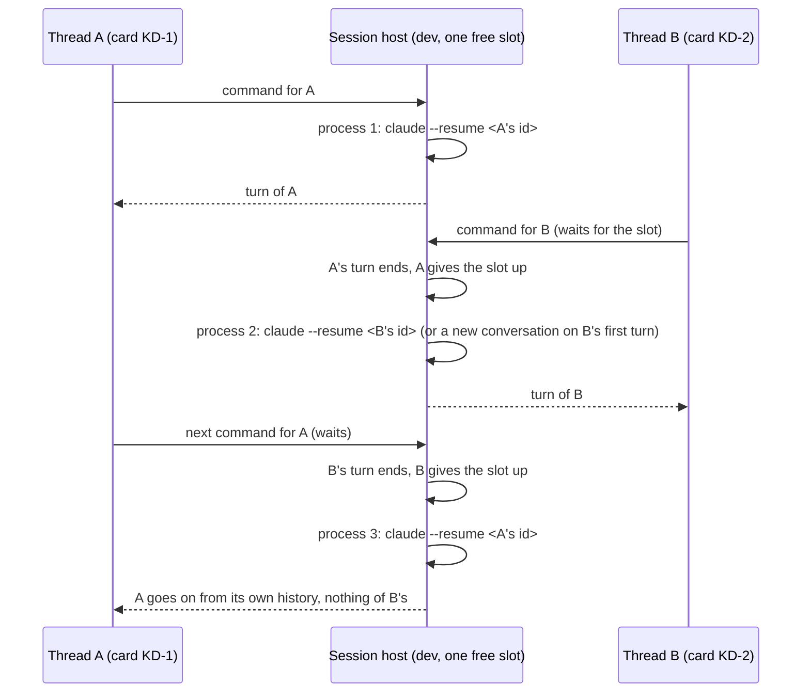
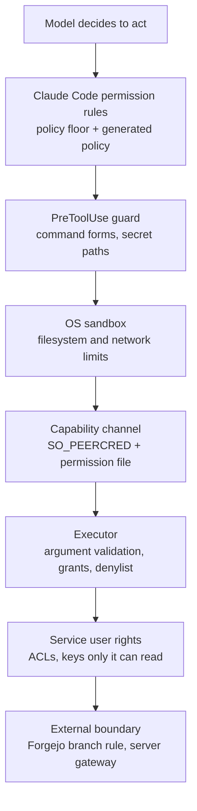
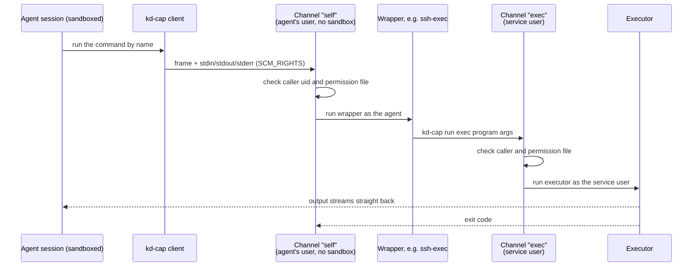
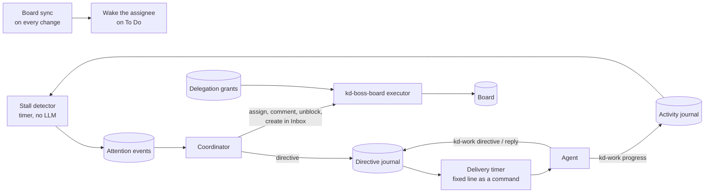
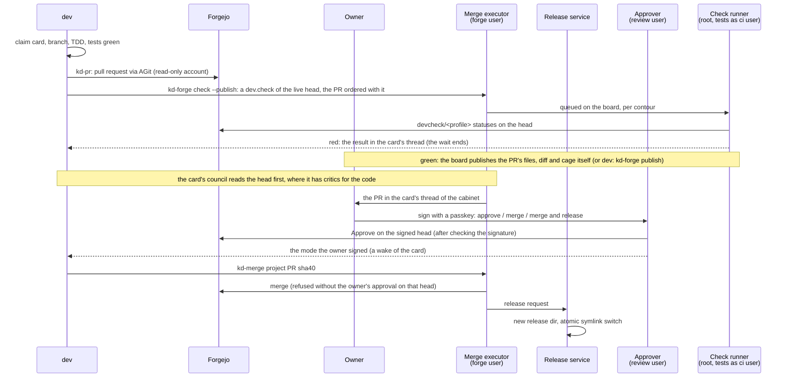
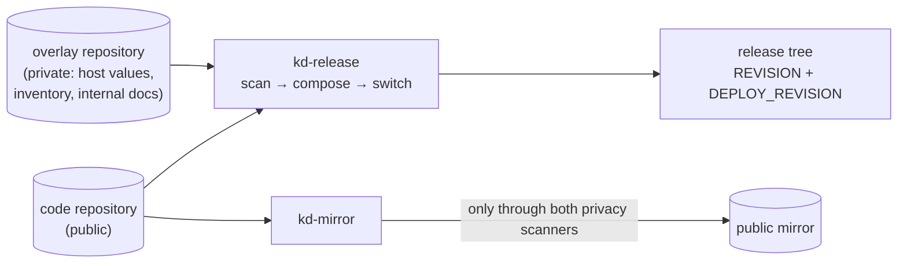
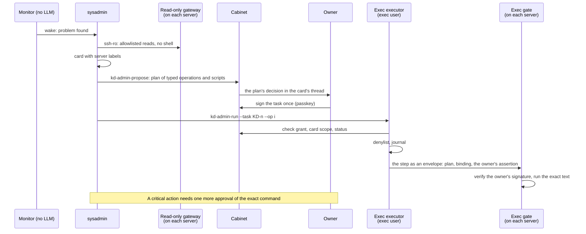

# Architecture

DigiPaddock runs every agent on one Linux host. Agents reach the outside world (code hosting, managed servers, the owner) only through narrow, checked paths.

## Components

| Component | What it is | Runs as |
|---|---|---|
| Agent session | Claude Code with generated settings, sandbox and hooks, started by the session host for one card thread or the agent's chat | the agent's own user |
| Board | A SQLite database behind one socket service (`kd-cabinet`): typed operations only, the caller identified by its Unix credentials, compare-and-swap by card revision, an event recorded with every write; the agents' executor `kd-task`, the coordinator's executor and the owner's pages are its clients. A nightly Markdown snapshot in git mirrors it for reading. It also holds the outbox: every intent for an agent on the session host is a command written in the same transaction as the event that asks for it, and the board's dispatcher delivers it | own service user; nobody else opens the database |
| Session host | Runs the agents listed in its configuration as headless Claude Code sessions, one per card thread or agent chat, and every worker job, each a transient systemd unit under the agent's user; session slots per agent with a queue, and a separate pool of worker slots; reports turns, the agent's messages, each turn's usage and each job's end back to the board | root; takes requests from the board's service user only |
| Memory | Hindsight API and worker with PostgreSQL; a role bank per agent and a project bank per project ([Hindsight settings](hindsight-settings.md)) | own service |
| Notices | What root services and executors tell the owner — a unit's failure, the monitor's fallback when the sysadmin is away, stalls without a coordinator, a server run's result, a merge or a release: a catalog key with parameters, posted to the card's thread or, without a card, the journal — where the incidents page lists the warn and critical ones as platform alerts (`notice.list`) and their push leads — with push by level. The alert hook also sends a plain-text duplicate of a critical alert to Telegram; nothing else goes there | the board (`notice.post`); posted by root, the exec user and the forge user |
| Capability channels | A socket per (agent, channel) with a per-connection service | the user of that channel |
| Executors | Programs that validate and perform privileged effects | service users |
| Worker slots and jobs | Prepared slot folders per agent; the jobs live on the board: one request per card and specialization, one writer per card, finite states. The board hands a queued job to the session host, which runs it in a free slot of its agent: a root runner reads the job from the host, verifies it against the registry, prepares the slot's working copy on a pinned base commit, writes the job's settings and system prompt, and runs Claude Code headless as the agent's user. Its one end line (outcome, result block, usage) goes back to the board, which records the result, posts a card comment on the agent's behalf and wakes the requester; the job's commits reach the agent as a patch in its temporary folder. A job the host was running when it restarted fails with that reason, never runs twice | base user (executor); root (session host, runner); the session and the slot under the agent's user |
| Grants | The owner's signed decisions — a sysadmin plan, a critical command, a delegation, a factory step — as records only the cabinet service writes and the executors check | `<prefix>-cabinet` |
| PR approver | Checks the owner's passkey signature over a pull request decision itself and posts the Approve in Forgejo with its own token | `<prefix>-review` |
| Diagnostic help | `kd-diag`: one typed check of a target from a root-owned catalog — a health probe (a loopback `http://` URL with a port; one GET, the status line only, no redirect followed, no body read, a short timeout) or a fixed read-only query of the board (the cabinet's push path) — for the card's single assignee while the card is approved, a limited number per card per hour; the result is a message of the card's thread | base user |
| Repository checkouts | Read-only clones of the registered repositories, refreshed every 10 minutes with their own read-only deploy key; agents with `repo.read` read them | `<prefix>-repo` |
| Dev checks (`dev.check`) | The required checks of a pull request's head: a board operation queued per check contour (a contour from the release tree: what it checks, how many at once), run by the session host as a root runner that checks out the head with the contour's other components, prepares the dependencies by lock hash, runs each profile in its own unit with no network and no sockets, writes the `devcheck/<profile>` statuses on the head with its own token and posts the result into the card's thread | root (runner); the tests under `<prefix>-ci` |
| Model keys and provider transport | The provider-key writer: the cabinet passes it a key the owner entered and signed with a passkey; it verifies the signature against public keys root enrolled itself and writes only the catalog's key files (`kd-model-keys`, a socket only the cabinet reaches). A loopback adapter lets Claude Code sessions run on OpenAI models over OpenAI's fixed endpoint, without storage or request logging (`kd-openai-bridge`) | root |
| Release service | Unpacks a merged commit as a new release and switches a symlink | root, triggered on request |
| Coordination timers | Stall detector, directive delivery, morning digest | base user / root |
| Monitor | Scheduled checks of managed servers, alerts without an LLM | dedicated units |
| Usage accounting | Tokens, cost and cache hit rate per agent and model, a daily summary in the system journal (the cabinet's morning digest reads the same ledger): hosted turns and worker jobs from the board's per-turn usage ledger, older sessions from their transcripts | root (the daily summary reads every agent's transcripts and the board's ledger); the board (ledger) |

## Agents, specializations and skills

An agent is the executor; a specialization defines its work procedure and expected result; a skill adds reusable professional knowledge. The agent's type and selected capabilities determine its powers.

| Concept | Question it answers | Example |
|---|---|---|
| Agent type (profile) | Which capabilities may an agent hold? | `analyst`, `developer`, `coordinator`, `sysadmin` |
| Persistent agent | Who performs the work, under which identity? | `@dev` or `@analyst`, with its own Linux user, configuration, memory and cabinet chat |
| Specialization | Which procedure and result contract apply to this task? | `implementer`, `reviewer`, `copywriting`, `ui-design` |
| Skill | Which reusable subject knowledge applies during that procedure? | `frontend`, `python-backend`, `security-review`, `stateful-testing`, `localization`, `e2e-testing` |
| Worker session | How can more work run concurrently? | A temporary job of the same agent, with a selected specialization and skills |

One agent can use several specializations across its cards. One card selects one specialization with `spec:<name>`; without a label, the agent uses its type's default if one exists. A specialization belongs to one type and is installed only when its `requires` are already among the agent's capabilities. Skills are selected for an individual job from that specialization's allowlist: being available does not mean every skill is loaded.

For example, `@dev` of type `developer` can implement a screen as `implementer` with `frontend`, review it as `reviewer` with `frontend`, or prepare a prototype as `ui-design` with `frontend`. The procedure and output change; the frontend knowledge is reused. This is why frontend development uses a skill alongside `implementer` rather than a second implementation procedure.

The same distinction explains the two copywriting specializations: `@analyst` with `copywriting` puts text drafts on the card; `@dev` with `site-copy` changes repository files and opens a pull request. The required actions determine the type. A new subject usually needs instructions; access to a new data source or external effect needs a capability and its checked execution path.

Neither specialization nor skill grants powers. Worker policy is the intersection of the agent's policy and the specialization's limits. The model is configured separately: changing instructions does not create a new agent identity or grant tools.

**Persistent skills:** the registry and worker launcher support selected skills, at most two per job, with compatibility/conflict checks and recorded versions and hashes. Persistent cards select the same skills with `skill:<name>` labels. Claim checks installed copies; before every turn (including resume), the session host rechecks the selection and installed bytes, records changed provenance, and supplies the current checked texts. Incompatible skills on a reassignment are refused atomically; remove or change the selection in the same edit. A persistent agent asks for missing inputs on the card and handles pull requests; a worker returns `blocked` with missing inputs, or its result and, where applicable, a commit for the lead to integrate.

Skills and specializations are versioned Markdown instruction texts used in the model's prompt. A worker receives its runtime frame, specialization and selected skills as system instructions, with the card brief separately as task data; a job the cabinet starts itself (a council's critic) also carries the files it reads instead of the board, which the runner writes read-only into the slot's `work/inputs/`. A persistent card receives the current checked texts before each turn. Text loading does not execute a tool: the separate capability channel and sandbox still determine whether an action is available. In particular, `e2e-testing` supplies knowledge while `e2e.request` permits only the prepared smoke executor.

The implemented additions include independent `brief-review`, stateful/localization/browser skills, the `release-check`/`post-deploy` pair and sourced `support-draft`. See [Skills and specializations](skills-and-specializations.md) for their source files, compatibility, outputs and current runtime limits. See [Team model](team-model.md) for selection rules and when a new specialization, skill, agent or capability is appropriate. The executable catalog is [specializations.json](../common/specializations/specializations.json); worker prompt composition is in [worker_packs.py](../common/kd/worker_packs.py).

## Agent from settings

A new persistent agent is assembled from data. Its manifest selects a registered type (profile), capabilities and runtime configuration. A new specialization or skill is added to the instruction registry; a new capability needs an implementation when its trust boundary does not exist yet. The registries are finite; the manifest only selects from them.

- `new_agent.sh --check <agent>` validates everything without changing the host. `--plan` prints the exact users, ACLs, files and units it would create. `--install` applies them; `--disable` stops the agent and removes its powers but keeps its home, memory and secrets.
- The compiler refuses dangerous `allow` rules, `allow`/`deny` conflicts, unsandboxed modes, arbitrary absolute paths and network access beyond the module's allowlist.
- Shared instructions (cabinet, board, memory, data-not-commands, notes) live in one template, rendered in the owner's language of the deployment (`owner_language` of `host/host.json`). A shared section that describes a power is rendered only for agents that have that power.
- An agent's instruction is a small always-loaded core plus playbooks read on demand. The core is the rendered `CLAUDE.md` (the role text and the shared sections): it goes with every request of every session, so it holds only what any turn needs — the rules the hook refuses, how a turn ends, the prohibitions, the order of work. Occasional procedures live in `agents/<name>/playbooks/*.md`, installed root-owned beside `CLAUDE.md` with `{{host.<key>}}` filled in, and the core names each one in a pointer that says when to read it (`playbooks/<file>.md`). A playbook is read with the Read tool like any file; reading it grants no right. The developer's core has a size budget (50 KB assembled, kept by a test in `agents/dev/tests/test_agent_config.py`, which also checks that every playbook a pointer names exists), so a new procedure goes into a playbook, not into the core. The sysadmin's core includes the deployment's server table (`agents/sysadmin/servers.md` of the overlay), which is larger than the example the public tree renders with: the role is not installed when the rendered text passes 96 KiB, so a test in `agents/sysadmin/tests/test_agent_config.py` keeps 10 KiB of room under that limit, and the role's occasional references (`typed-steps.md`, `monitor.md`, `factory-host.md`) are playbooks.
- After a release, generated agents whose install differs from the new code are reinstalled by the factory, not by hand: the release (or the developer, with `kd-factory`) asks for `agent.reinstall` under a factory grant on its card — the same schema-2 plan and grant store as the sysadmin's server work, with its own catalog (this host's generated agents only). The session host pauses the role (its queue is kept), waits until its sessions and jobs end on their own, runs a root runner that verifies, installs and checks each role, and resumes it; a failed role stays paused and the owner is told. A role's check refuses only on that role's own problems — another role still waiting for its turn is a warning, and the release's postflight still checks the whole host. Each stage's output reaches the runner unit's journal only masked, and only its last MiB (the runner reads it as it comes and keeps no more; a first line says how many bytes went before); a failure's notice in the card's thread names the role, the stage, the batch's unit, the masked tail of the output, the roles left on the old version and the retry under the card's grant, and the agent leading the card (and the sysadmin) reads the operation's journal with `kd-host-read journalctl --operation <id>`. The waiting turn ends with `wait_dependency --operation <id>`, and the operation's end continues it through the pipeline's limits.
- The same catalog has `component.install`: a platform component (repository attach, voice transcription, the e2e runtime, dev checks, the session host) in one of its fixed modes. The owner signs the step on the deployed release tree — the code's revision and the overlay's, so a release of either ends the signature (a step written on `"revision": "release"` is requested by the release of the card's own pull request); the developer runs it with `kd-factory install`, a root runner of the session host runs the component's fixed command, and the exit codes and the masked output tail land in the card's thread. Anything outside the catalog — other installers, servers, packages, reboots — is not a factory operation.
- Code is still needed when an agent needs a new trust boundary: a new executor, secret, API, network host or kind of change. That code becomes a registry module once, and any later agent can select it.

## Session runtime

- Every agent runs on the session host: a checked launcher starts its Claude Code headless under the agent's user, one session per card thread or agent chat. The working directory is writable; the agent's folder (instructions, settings) is root-owned and read-only. An agent talks to the owner only in the cabinet: its turn's text is posted to the thread it was woken in, and a command comes only from a message a signed-in person wrote there. `kd-task chat --post` writes into the agent's chat from another thread (a card's, or the coordinator's “Monitor” with `--in-chat`); into its session's own thread the cabinet refuses it, so one answer is one message. The owner hears of a failed session and of an agent's message in its chat by push.
- Settings come from three layers: the host-wide policy floor, the generated settings, and root-owned launch settings. The agent cannot edit any of them.
- Hooks run on every tool call: a guard validates command forms and a permission logger records any approval request.
- The Claude Code version is pinned and auto-update is off. It is one root-owned binary for every agent, `/opt/digipaddock-claude/claude`, installed only after its sha256 matches `common/install/versions.json`; every launch execs it by that path, never a copy in a home. A new version is tried with the model and effort probes first, then released to every role at once (see [install.md](install.md#updating)).
- A session's process closes after ten idle minutes and the next command resumes the same conversation; another thread is another session with a conversation of its own. Commits, card notes, the agent's notes and the memory bank must hold everything that matters across threads. The whole lifecycle is in [Session lifecycle](#session-lifecycle) below.
- Each thread keeps its working data apart: `agent-launch` makes the thread's own notes and temp folder from the routed context — a card's `memory/tasks/<card>.md` and `work/tmp/cards/<card>/`, the chat's or “Monitor”'s `memory/chats/<thread>.md` and `work/tmp/chats/<thread>/` — names them in the session note (`KD_SESSION_NOTES`, `KD_SESSION_TMP`), and a resumed thread gets the same ones. The shared `memory/notes.md` is read-only to the agent's tools; `kd-notes add` (the agent's self channel) appends one dated entry under an exclusive lock, so concurrent sessions lose nothing. All sessions of an agent run as one Unix user: this is the layout and the control of the regular paths (policy, sandbox, the dev guard), not isolation between processes. A worker's patch goes to its card's temp folder.
- Every agent runs on the session host; there is no panel and no Telegram channel. Moving a card to work, sending it back from review, a person's message naming the agent, an answer to its question, a ready brief, or a signal from the coordinator, the stall detector, the monitor or a worker becomes a durable command in the board — card work in the card's thread, a signal without a card in the agent's chat: a unique key makes a repeated event, request or delivery harmless, and the board's dispatcher retries with backoff and cancels a command whose card has moved on. The host runs the same checked launcher in session mode under the agent's user, one session per thread, and resumes the conversation after an idle stop (an agent's «Monitor» thread starts a new one for each wake instead: see Session lifecycle). An agent's ready threads share its slots one turn at a time: when a turn ends with more messages for its thread while another thread of the same agent waits and no slot is free, the session closes between turns and goes to the tail of the agent's queue, resuming its own conversation when its turn comes; with nobody waiting the next message goes to the same process, and a running turn is never cut. A session's agent, thread and card (or the agent's chat) are fixed by the board's routing: the host refuses a delivery that names another before it queues, a card's command outside its card's thread is never sent, and the launch names the session's card or chat to the model from these checked ids, so no card or message text can move a session to another card. The owner sees in the card whether the request was accepted, the agent is working, waits for a slot (with the thread's place in the agent's queue and how long it waits — never an estimate of the time left) or behind its own thread's turn, or failed, and can stop or continue a session. Tool output never reaches the thread, which shows a tool's name and a masked one-line summary; the card's Sessions tab shows each turn of a session — the command that started it, its steps, its result and cost — and, to people who may steer the agent, a tool's output masked by the gateway's secret rules and cut to 4000 characters, kept apart from the thread. When the host restarts, sessions that were running are marked failed and offered to continue, commands that never started go back to the queue, and nothing runs twice. Every wake goes through one facade: a listed agent gets a command; an agent that is not on the session host is not woken.
- **Command keys are the board's.** The keys the board writes itself — an event's wake, a chat message's, a resolved wait's, a continuation's, a defer's time, a council's, help's — are predictable, so nobody else may take one: `command.enqueue` refuses their prefixes from every caller, and an agent's own signal (the monitor waking its agent) is stored under `agent:<name>:<key>`. An agent signals itself on a card only while it holds that card in work, and such signals count in the card's continuation window (six turns an hour by default) with the continuations; one left on a card the agent no longer holds is cancelled before delivery. A key taken anyway by a row from before is not a failure of the write that needs it: the board's own command goes under that key with a `!` (a character no caller's key may hold), and the owner's answer, the event or the sweep goes on.

### Session lifecycle

The terms are those of the [glossary](glossary.md): an **agent** is a role with its own Linux user; a **session** is one agent in one thread, a board record with the conversation's **runtime id**; a **Claude process** runs a session's turns while it lives; a **slot** is the right to hold one process; a **turn** is one command's run. The host's state machine is `common/kd/session_host/core.py` (its module docstring is the reference); the launch is `common/bin/agent-launch`.

**One session, many processes.** A session is fixed to its agent, thread and card by its first delivery; a later delivery that names another is refused before it queues (`core.py`, `_same_context`). Its process reports the Claude Code session id, which the board stores as the session's `runtime_session_id` (`core.py`, `Host.runtime`; `common/kd/cabinet/sessions_api.py`) and sends back with every delivery (`common/kd/cabinet/dispatcher.py`, `"resume"`). A process the host starts with that id runs `claude … --resume <id>` (`agent-launch`, `resume_args`), so the conversation goes on where it stopped. A session with no process and no input is dropped from the host's memory; the board's record keeps the id.

**«Monitor» starts a new conversation per wake.** An agent's «Monitor» thread (the monitor's events, the coordinator's attention ticks) is the exception: the board sends no runtime id with its deliveries (`dispatcher.py`, `_prepare`), so a wake that finds no process of the thread starts `claude` without `--resume`, and a long-lived thread no longer reloads weeks of history on every event. A wake that comes while the thread's process is still alive (within `idle_minutes` of the last turn, or behind a turn under way) goes into that process, as in any thread; a process the host itself restarts with inputs still waiting (a slot given up, a pause) goes on with the conversation of that process. What earlier wakes said and did reaches a new one as data, never as memory: the wake's own text, the thread's last messages (`kd-task chat`), the thread's notes, the board and the monitor; a person's message there wakes the agent with the number of its own last message before it (`sessions_api.MONITOR_LAST`). Each new conversation reports a new runtime id, which starts the ledger's count anew (`usage.py`): its first total is counted whole, the next turns of the same conversation by their difference. The session's record, its Sessions tab, the `monitor` usage category and the incident links of the sysadmin's reply are per thread and command, and stay as they were.

**What closes a process, and what the next turn does.**

| Event | What happens | Next turn |
|---|---|---|
| Idle for `idle_minutes` (10 by default, `common/kd/session_config.py`, `IDLE_MINUTES`) | `Host.tick` closes it | a new process with `--resume`: the same conversation |
| Another thread of the agent waits and no slot is free | after its turn the process closes and the session goes to the tail of the agent's queue (`Host.turn_ended`, `_yields`; KD-9047); a running turn is never cut | `--resume` when its place comes |
| A reinstall (`agent.reinstall`) pauses the role | idle processes close at once, a working one after its turn (`Host.pause`); one that ends between turns just ends (`Host.exited`) | `--resume` after the role resumes |
| Model or effort of the card changed | the process closes (an idle one at once, a working one after its turn) | a new process on the new pair, with `--resume` |
| The role's context limit changed (Settings → Models) | the same: an idle process closes at once, a working one after its turn | a new process with the new limit, with `--resume` |
| A resumed process exits before its first output line | the conversation it resumed is gone or cannot load | the same input once more **fresh**, without `--resume` (`Host.exited`) |
| After a switch of model the API rejects the old history and nothing was answered | the new model would not take the previous context | the same input once more **fresh**; the thread gets a status line «history not carried over» (`Host.turn_ended`, `HISTORY_DROPPED`) |
| The process exits on its own during a turn, or the host restarts | the turn and the inputs it held fail; the cabinet offers «Continue» | the continued command resumes as usual |

Apart from a thread's very first turn and a «Monitor» thread (above: every process that starts for a wake there is a new conversation), those two fresh starts are the only cases where a thread's turn starts a new conversation. There is no scheduled reset of sessions: no timer restarts them at night or at any other time.

**Compaction at the role's context limit.** What keeps a long conversation from growing to the model's whole window is Claude Code's auto-compaction, at the role's session context limit (the cabinet's [Settings → Models → Context limit](cabinet.md#session-context-limit): one value per role, 400 000 tokens by default, or none). The board keeps it per role (`common/kd/cabinet/context_limits.py`) and puts the value in force into every delivery of the role as `context_limit` (`dispatcher.py`, `_prepare`; no limit — no field) and into each worker job's definition as the job is sent (`jobs.prepare`). The host starts the process with the plain unit variable `CLAUDE_CODE_AUTO_COMPACT_WINDOW=<tokens>` (`server.py`, `_spawn`; `common/kd/context_limit.py`), which `agent-launch` passes on to `claude`; the worker runner sets the same variable in the job's environment (`worker_runner.env`). The value is never in the role's installed settings, so a change needs no reinstall; like a model or an effort, a delivery with another limit restarts the session's process between turns (the table above). A host older than the field refuses it, and the board sends the delivery once more without it: the session then runs on Claude Code's own window. Claude Code reports a compaction as a `compact_boundary` event with the size before it; the host turns it into a status line of the turn, `sys.session.compacted`, with the size before and the next request's context (its input, cache read and cache write) as the size after (`claude.py`, `Normalizer`; a turn that ends first gives the size before only).

**Waiting for a slot.** An agent has a fixed number of slots (`session-host.json`; each agent's number is in [Roles](roles.md)). A command for a session that has a process waits for that session's current turn to end; one for a session without a process waits in the agent's FIFO until a slot frees — when another session's turn ends and it gives its slot up, or an idle process of the same agent is closed to make room. Each waiting thread sees its place in that queue in the cabinet. Worker jobs use a separate pool and never wait for sessions (see Worker slots and jobs above).

**A → B → A.** Two threads of one agent never share a conversation, whatever the slot does:

Examples:

- **A card.** The owner moves KD-1 to To Do: the developer's session of KD-1's thread starts, works, ends its turn on a wait. Ten minutes later the process closes. The owner's answer a day later is a new turn of the same session: a new process resumes KD-1's conversation.
- **The agent's chat.** A message in the developer's chat goes to its chat session, a conversation apart from every card; work the chat routes into a card runs in that card's own session when its wake comes.
- **«Monitor».** The monitor opens P-7 at night and wakes the sysadmin in its «Monitor» thread: a new conversation looks and reports. P-7 closes the next day: another new conversation reads the event's line and the card labelled `P-7`, not the night's context. The owner's answer to the night's report wakes a third one, which reads that report by the number its wake names.
- **Two developer slots.** With two slots, KD-1 and KD-2 run side by side, each in its own process, conversation and worktree; a third ready thread waits for one of them to end a turn.
- **Reading a related card.** KD-1's session may read KD-2 with `kd-task view KD-2`; that reads the board, not KD-2's conversation, and KD-2's work still runs only in KD-2's session.
- **Shared and per-thread notes.** A pitfall found on KD-1 goes into the shared `memory/notes.md` with `kd-notes add` and every session reads it at its start; KD-1's progress goes into `memory/tasks/KD-1.md`, which only KD-1's thread keeps.

**What a session is given explicitly.** Nothing passes between conversations by itself. At every start, fresh or resumed, a process gets: the agent's `CLAUDE.md` (the role text and the shared sections of `common/agent-template/CLAUDE.common.md`) with its settings, hooks and sandbox; the session note `agent-launch` appends to the system prompt — the thread, the card or chat, the rule that the session works only that card, the thread's own notes and temp folder (`KD_SESSION_NOTES`, `KD_SESSION_TMP`) and, on a project with its own memory bank, that bank; the selected specialization and skill texts, checked before every turn; and the command's own text. What it learns about other threads it reads on purpose: the board, its notes, the memory bank, the repository.

**Cache and history are different things.** The *history* is the saved conversation of one session, which `--resume` loads again ([Claude Code CLI reference](https://code.claude.com/docs/en/cli-reference)). The *prompt cache* is the model provider's reuse of an identical prefix of a request's input — the system prompt, the instructions, the conversation so far — across requests ([prompt caching](https://platform.claude.com/docs/en/build-with-claude/prompt-caching)): it saves cost and time, holds nothing a request did not send, and expires on its own, independently of the history — a resumed conversation is complete even when nothing of it is cached any more, it is only written to the cache again. The *memory bank* (Hindsight) is a third thing: facts an agent stored on purpose, shared by the sessions that use the bank. In the usage ledger (`common/kd/cabinet/usage.py`) `cache_read` and `cache_write` are sums of tokens over all the model requests of a turn or a period, as the provider reports them per request: a turn of twenty requests over a long conversation reads its prefix twenty times. They are neither the size of the context nor anybody else's conversation. `kd-usage` reports the cache hit rate as `cache_read / (input + cache_read + cache_write)` (`common/bin/kd-usage`, `cache_hit`).

## Layers of control

Each layer works on its own. The sandbox does not trust the hook, the executor does not trust the wrapper, and Forgejo does not trust the merge executor. Details: [Security model](security-model.md).

## Capability channels

Sandboxed commands cannot use `sudo`. A sandbox exception that depends on Claude Code parsing the command text breaks on unusual command forms. So every privileged command goes through a socket instead:

- One connection is one call. The service passes the caller's own stdin, stdout and stderr to the program, so output streams straight back to the session.
- If the client disappears (a timeout or a stop), the service kills the program's process group.
- Each call runs in its own unit instance, at most an hour, 3 GB of memory with no swap and 1024 tasks with everything it starts: a runaway executor or test run fails alone.
- No permission file means the channel is off. Stopping the channel target stops every channel of every agent at once.

## Coordination

- **Sync.** When a card moves to `To Do` with one assignee, that agent gets a fixed wake-up line. The wake-up is a command in the board, retried until the session host takes it; it is dropped after 24 hours or once the card is closed or handed to someone else.
- **Wakes that come together are one turn.** A person's message to the agent and the owner's answer on a decision of its card do not wake it while its turn in the card's thread runs: they wait for that turn's end. The owner's approval or rejection waits a short window (two minutes) only while the agent has another decision still open on the card; his last answer goes at once and takes the waiting ones with it. Then the waiting wakes of the card go to the agent in one delivery, their lines joined in order; each command keeps its own key and ends with that turn — or goes back to the queue on its own when the delivery or the turn fails. A delivery sent again after a lost answer carries the same wakes as the first time; a wake held behind a turn counts its day of delivery from that turn's end, as it would have waited at the host behind it.
- **Stall detector.** Rules for `Blocked` cards, `In Progress` cards without verified activity, `Review` without the owner, `Inbox` without a decision, and due dates. Without a coordinator its events reach the owner as one notice without a card. An empty tick costs nothing.
- **The next step after a turn.** A turn on an agent's own card in work ends with a recorded outcome (`kd-work finish`): continue, wait for the owner's decision, wait for a dependency, Review or Done. The board applies it when the session host reports the turn's end, in the same transaction: a continuation in the card's thread, waits that resolve from their sources in the transaction of the settling event, or the card's move within the closing policy (Done only by the agent the project's settings name to close its cards — otherwise Review and the owner's acceptance — and with nothing open). Review and Done through `kd-task edit --status` pass the same guards as the outcomes `review` and `done`: the council's unanswered findings, open help, an aggregate's open stages, the closing policy. A turn that ended without an outcome while help it asked for is still open waits for that help: the board records the wait itself. A card put off by the owner or the coordinator stays put off: the agent's `wait_until` neither replaces that defer nor releases the wakes it holds — its own moment wakes it no earlier than that defer's time. A turn that leaves nobody on the card, an outcome that cannot apply and continuations at their limit are problems: in enforce the coordinator is asked, on its own card the owner. A sweep each scheduler tick repairs what an event missed; the mode (observe or enforce) is a root switch on the host (`pipeline_setup.sh enable|disable`), and `kd-cabinet pipeline inventory` lists stuck cards without changing anything. Observe starts no continuation and asks nobody about problems; it never relaxes the closing policy — `kd-work finish --outcome done` and `kd-task edit --status Done` are held to it, a chain stage to its gate, in both modes.
- **Briefs and questions.** A card's brief is versioned in the board: the analyst's ready handoff records a version, a change of the text afterwards makes it stale, and a start — the owner's click or an approved coordinator proposal — approves exactly the version shown, so an older approval never starts a newer text. A brief's stages are part of that version: the approval creates their child cards (dependent ones Blocked with real dependencies), the parent becomes an aggregate that moves to Review by itself when its last stage is done, and a stage left without a card is a problem the sweep raises until it exists. Stages of one role in one repository are a chain plan: they share one branch and one pull request of the parent, a handed-in stage gets a reviewer job on its own commits, the coordinator's typed operation closes it, returns it or holds it for the owner, and after the last stage the plan's agent leads the pull request to the owner's one decision ([cabinet](cabinet.md#a-chain-plan)). An agent asks a person either in plain text or with a typed question form; the answer is stored as a structure and as readable text, and reaches the agent as both.
- **Overview and agent facts.** The cabinet's first screen and the agents' states are computed in the board from cards, commands, sessions and open questions — only on what the reader may see, before anything is counted. A long thread and a card's history are read in pages; live screens refresh at most once a second under a stream of events and say how fresh they are.
- **Help inside an approved card.** The card's lead may ask another role for one read-only step (a server, the platform, code it does not hold): the request names a kind from a fixed catalog, the step and a key, and is accepted only from the lead's running turn on its card in work. The coordinator assigns a role of that kind; the board wakes the role on the lead's card, and its answer — done with evidence and the limit of the check, or failed with a reason — lands in that card's thread and settles the lead's wait. Only the outcome settles it: the help taken or assigned wakes nobody. A rollout the helper cannot run itself is answered with the card of its plan (`kd-work assist reply … --card KD-<m>`): the lead's wait goes on to that card in the same write — the lead's card goes `Blocked` on it — and the plan card's Done wakes the lead once, not the answer. The lead cannot finish to Review or Done while its help is open. A request is withdrawn in the same transaction when the card leaves work, its lead changes or its scope changes; the sweep reminds the coordinator, raises a stalled help after an hour and expires one after a day. Help grants no right: the helper uses its own tools, and a change still needs its own approval.
- **Acknowledged events come back.** The coordinator acknowledges a stall event only with what it did (a help, decision, wait, job, card, directive, its own write or a question to the owner) and when to look again; at that time an event whose condition holds is pending again, its age kept. Events by age are one per card, whatever its revision.
- **Coordinator writes** go only through `kd-boss-board`: a finite set of operations, each with a reason, a card revision check and an audit record. It has no generic edit and cannot change titles, descriptions, acceptance criteria or most statuses: `Review` only for checked work nobody leads, and `Done` or back to `In Progress` only for a handed-in stage of a chain plan (`stage-pass`, `stage-return`), on the cabinet's code review of it. A card it creates carries only its reason in the description: the duplicate check behind it (the candidates it read and how the new card differs) is kept in the audit record, not in the card.
- **Directives.** Stored in a journal written only by the base user. A directive the board did not take is sent again every minute; a directive expires after 24 hours. Revoking a delegation grant withdraws the directives under it.
- **Observation.** The coordinator sees another agent's sessions in the board (state, card or chat, last update, error) and its verified activity, never the text of its turns. What it reads is data, never grounds for an action.

## Memory

| Layer | What goes there | Lifetime |
|---|---|---|
| Git commits | Code and work in progress | permanent |
| Card notes and comments | State of a task, agreements with the owner | until archived |
| `memory/notes.md` | The agent's shared notes, read at session start; appended only by `kd-notes add` | permanent, per agent |
| `memory/tasks/<card>.md`, `memory/chats/<thread>.md` | A thread's own notes: plan, progress, next step | permanent, per thread |
| `memory/legacy/` | The notes before the one-time split, byte for byte, and the map of what moved where | permanent, per agent |
| `work/tmp/cards/<card>/`, `work/tmp/chats/<thread>/` | A thread's own temp files; a worker's patch for the card | per thread |
| Hindsight bank | Dated facts: decisions, pitfalls, finished cards | permanent, searchable |

Agents write memory explicitly. Transcripts are never ingested.

## Delivering code

- The developer's shell runs in a sandbox that can reach only Forgejo. It cannot push; the pull request goes up through AGit, into the project's target branch, from an account that has no write access to it.
- Each project has a passport in the repository registry: its base branch, the target branches a pull request may go into, the checks a merge needs green (statuses on the head), whether the branch must be current with its target, and what a merge into each target sets off. A pull request of a project with required checks is a draft until they are green; the PR block in the cabinet shows the target, the effect and the checks, and the owner's signature covers the target too.
- The required checks are run by the factory, not by the developer's sandbox: `kd-forge check` asks for a `dev.check` of the live head (the forge executor reads it; the board has no code-hosting access) with the target's head and the heads of the contour's other components; the same head, profiles and set answer the same check. The board queues it per contour — an exclusive contour one at a time, another up to its capacity — and the developer's turn ends on the check as a wait; its end wakes the card. With `--publish` the forge executor also reads the pull request as a publish would and the board keeps it with the check: on a green end the board publishes it itself, in the same write, and the developer's wait goes on to the owner's decision on that head (or to the round of the card's code council that reads it) — no turn in between. A red end, or a publish the board cannot make by itself (the card left the developer, a chain plan's stage, a head another signature may carry to, council findings not answered, a pull request that moved in the board since the order — another head published, closed or merged — or a check flagged to stop that still reported green), wakes the developer as before. The pull request stays a draft in the code host until the merge: the merge tool takes the draft mark off once the owner approved the head and the required checks are green. A root runner checks out the head into a fresh directory with the target's head the check was asked for as `refs/kd/base` (a checkout that holds that commit neither from the pull request nor from the target is `superseded`), prepares the dependencies from the locks (a cache by lock hash; a changed lock is a new build — fetched with network by a downloader that installs nothing, installed with none — a failed build or a lock that names an index, a link or another source is `dependency_update_required`, not a red test), runs each profile in a child unit under the ci user — no network, no board or session-host socket, no secrets, CPU and memory limits, a time limit, and, like every unit of the ci user (each dependency build step, the daily vulnerability scan), a pid namespace and `/proc` of its own, entered by `unshare` and `setpriv` before the ci user's command runs, so that another check's unit of the same user cannot reach its processes or, through them, its work folder — and writes the `devcheck/<profile>` statuses on the head with a token that can write statuses and nothing else. The class of the end (`passed`, `checks_failed`, `environment_not_ready`, `dependency_update_required`, `external_unavailable`, `superseded`, `cancelled`, `host_lost`) says whose move it is; a contour that cannot run checks goes into maintenance and stays there until root releases it. A profile stopped by its time limit still logs the tail of what its running step printed, and a Python test running past five minutes dumps its threads' stacks there. The full log is a host-read root for the agents; the card's snapshot has a `checks:` line.
- Forgejo's branch rule on every target branch enforces the Approve, not the agent's instructions. A new commit dismisses the approval.
- The owner approves either in Forgejo or in the cabinet. The cabinet has no network and no code-hosting token: the forge executor publishes the PR into the board, and a separate approver under its own user and token posts the Approve only after it has checked the owner's passkey signature itself — over the decision, the head, the target branch, the mode the owner chose (approve only, merge, merge and release) and a fresh nonce, with the public key root registered for him. Its Approve counts only because the branch rule names it next to the owner. Remarks are recorded in the thread first and reach the PR as line comments.
- The cage of a merged pull request takes effect through the release and the factory: the release service renders the units and updates the cabinet, and asks the factory to reinstall the generated agents it would install differently; a catalog component is installed by the factory under the owner's signed step; any other installer is the owner's to run. The long-running session host keeps the code of the release it started from: it pins that release, so the release service never prunes it, and when a release changes the host's code the service asks the factory to restart the host once the roles' turns end. After the release the service runs a health check of the platform (session host and its code, web server, board, schema, queues) and posts its result into the card's thread; the card's release state is derived from those facts (merged, code switched, activating, healthy, degraded), a degraded release is a problem held by the card's lead and re-signalled to the coordinator until a healthy check or the next release. A component step a brief or plan writes on the release's own revision is signed once and requested by the release itself on the revision it brings.

## Repositories: code and deployment overlay

- The factory is two repositories on the forge. The **code** repository holds no value of a concrete deployment; the **overlay** of a deployment holds its host values, server inventory, the files listed in [deployment-overlay.md](deployment-overlay.md) and its internal documents. Both are board projects: a card that changes inventory or web-server values gets a second pull request in the overlay project, approved on its own.
- A release is the pair. The release service fetches `main` of both; the installed release tool checks the overlay as data (an overlay carries no code: no executable, no script); then, in a sandbox without network, secrets or a writable tree, the privacy scanners run over the code tree alone (a public scanner of the code — public addresses, forbidden domains, secret-like strings — and the installed tree's closed scanner with the overlay's literal list) and the released code lays the allowed overlay paths over the code; then the release symlink is switched. The tree carries `REVISION` and `DEPLOY_REVISION`; operations the release orders are keyed by the pair, so an overlay-only change is a new release.
- The owner releases by pushing to `main` and asking the cabinet for a release of the project (`kd-cabinet release <project>` as root on the host); the developer agent releases through the merge executor after the owner's signed approval. There is no other way to put code on the host.
- **Rollback** switches the symlink back to a kept release (the previous one by default) and runs the same steps after a release: units rendered, the cabinet updated, the postflight and the health check. It is refused when the live board database already has a newer schema than the code rolled back to — then the fix goes forward.
- **Reading the public mirror.** The developer takes a branch the owner made on the mirror with `kd-mirror-fetch <branch>`: the forge executor fetches that one branch with its own read-only deploy key (the mirror's host key pinned, no hook, no global config) into a bare local copy, `/srv/digipaddock-mirror/code.git`, and the developer's `git fetch github` reads that copy by its path. The mirror's history is snapshots, not the forge's commits, so the developer takes the branch's own commits onto a branch from the forge's `main` with `git cherry-pick <snapshot>..github/<branch>`. Its sandbox reaches the forge only: no key for the mirror and no route to its host, so code it runs cannot carry a key or the board out through the mirror's host.
- **The public mirror.** Every five minutes, and after each healthy release, a root service publishes the code repository's `main` to the public mirror as a snapshot: one commit with the tree of that `main`, on top of the mirror's own `main`, by the deployment's `mirror_author`, titled `Update to upstream <sha>`. The forge's history — its commits, messages, authors, removed lines — never goes out, so the scanners read what is published: both of them over the tree, its file names and the snapshot's message and identity. A finding blocks that commit (one alert, then one a day); nothing is published until `main` moves on to a clean commit. The push is a fast-forward of the mirror's `main` as the run read it — never a force: a push to the mirror meanwhile fails the run, and the next one builds on it. A tag on the published `main` goes out as a plain tag of its snapshot; when the running tree has `host/allowed_signers`, only one signed by one of them under its own name — the rule `kd-release` applies to a tag; a tag on an older commit stays on the forge. A tag put on that `main` after it went out takes the next run, through both scanners, onto the mirror's `main` while that still has the same tree; the service remembers the tags it has decided, so each one is decided once and a run with no new tag does not reach the mirror. The forge's history keeps every merged line for good, so the history scan (`kd/history_scan.py`) runs before a merge: the `history` step of `devcheck/unit` reads every commit the pull request adds to `refs/kd/base` with both scanners, the closed one with the running release's list, and `scripts/check.py --profile static` reads the commits not on `origin/main` before a push. The mirror follows `main`, which code reaches only with the owner's Approve, not the released revision.

## Operating servers

- **Reads.** The gateway on each managed server is a forced command: allowlisted commands with checked arguments, run without a shell, secret paths refused, a 60-second timeout and capped output.
- **Changes.** A plan binds a card, its servers and the allowed operations — typed catalog operations and script steps whose exact text the owner reads before signing. Changing the card's scope (servers, assignee, description, criteria) after approval invalidates the grant. The executor never reads the agent's proposals: on approval the cabinet first keeps the exact signed plan (or critical action) beside its grant in the grant store, and the executor builds the envelope from that copy, checked against the grant's hash — a grant without its copy refuses and needs a new approval. On the server the exec key's forced command, `agent-exec-gate`, verifies the owner's passkey signature against a root-owned registry before anything runs and runs only the signed step — a script's text through bash, a typed step's own words without a shell; in `observe` mode it logs a failed check and runs, in `enforce` it refuses. A signed plan's steps run once each and in order: the gate journals each step's result and refuses a repeat of a success or a step ahead of an earlier one of its server, and the executor asks the gate of the step before when it ran on another server; a failed step may run again. The one step it runs unsigned, in both modes, is a test environment's own: the deployment marks project environments as test in the catalog, the cabinet approves a plan made only of their steps by rule, and the gate checks the step word for word against the root-owned list of test environments `deploy_target.sh` installed on that server. Its policy (`agent-exec-policy`, the same module `kd-admin-propose` runs) holds in both modes: a command that touches the gate, sudo, SSH or the accounts is refused, and so is a plan step the critical classifier recognizes — that one the owner signs as an exact critical action (see [security-model.md](security-model.md)).
- **Critical actions** need a one-time approval of the exact command. The denylist refuses some actions even with an approval.
- Every execution goes to an execution journal and a notice in the task card's thread.

## Observability

| What | Where |
|---|---|
| Server commands run by agents | execution journal |
| Merges, pull request comments, releases | forge journal |
| Approval requests from any agent | the permission audit file of the base user (never the system journal) |
| Directives | coordination journals |
| Tokens and cache hit rate per agent | usage accounting from the board's ledger, a daily summary in the system journal |
| What services and executors told the owner | notices in card threads and, without a card, the platform alerts of the incidents page; critical ones — a failed unit or agent session, a denylist refusal, a cabinet that does not answer — duplicated to Telegram |
| A session's turns, steps and masked tool output | the card's Sessions tab |
