# Cabinet

The cabinet is the owner's web application and PWA over the board. Everything a person does with the factory happens here: reading the work, answering agents, approving and signing decisions, watching the servers. Agents talk to people only in the cabinet; Telegram carries nothing but a plain-text duplicate of critical alerts.

One service under its own user (`<prefix>-cabinet`) owns the board's database and serves the web on a local socket behind the web server. Its interface strings come from the `ru` and `en` catalogs: each person reads it in the language set in their profile, else in the deployment's owner language (`owner_language` of `host/host.json`), in which the agents write too.

## People, roles and sign-in

| Role | Sees | May |
|---|---|---|
| owner | everything | everything: decisions and signatures, settings, people, projects |
| partner | the projects named for them | work on their cards: messages, answers, the card actions their projects allow; no servers |
| viewer | the projects named for them | read |

- **Sign-in** is a passkey, or a password with a one-time code (TOTP); a one-time code is accepted once. Five wrong TOTP codes in 15 minutes close the account's TOTP — password sign-in and step-up alike, from every address — for the rest of the window; a passkey still signs in. The first sign-in code of a person is made on the host as root (`kd-cabinet user add <id> --name … --role owner|partner|viewer [--projects …]`, later `kd-cabinet user code <id>`).
- **A new device**: Settings → Devices → «Code for a new device» gives a code valid 15 minutes, confirmed with a passkey (or a one-time code); a new code voids the unused old one. The owner gives a code to another person in Settings → People and roles. Every issued code is an event in the feed (who, for whom, until when — never the code).
- **Blocking**: «Block» and «End all sessions» in Settings → People and roles, or `kd-cabinet user block <id>` on the host.
- **Managing people** (`users.manage`) gives no more than one holds: a manager never changes their own roles, writes into a role or assigns a permission they do not hold themselves over those projects, and changes, blocks or gives a sign-in code to a holder of every permission (the owner) only if they hold every permission too. Root on the host is not bound by this.

## Screens

The pictures below are of the development cabinet with its synthetic seed (`kd-cabinet serve --dev --seed`; no
deployment's names). `npm --prefix common/cabinet/web run screenshots` takes them again into `docs/images/cabinet/`.
[Features](features.md) shows the same screens by what the factory does.

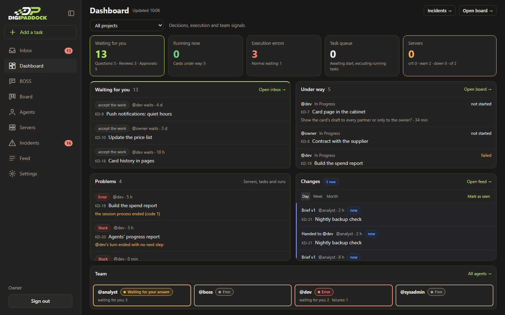

- **Overview** (the first screen): counters, then what waits for you, the work under way, problems (a failure apart from normal waiting), the period's changes (new since you last pressed «Mark as seen») and the team's states. Everything is counted only from the cards you may read.
- **Inbox**: decisions and questions that wait for you, and the open critical incidents nobody acknowledged or muted.
- **Board**: the cards by status; Done shows the last seven days («all · N» shows the rest). The project chips and the search are always in view; the four filters — status, assignee, specialization, label — open on “Filters” at any width (the button counts the active ones; a filtered board is a link and opens with them in view). “Add” — in the page's header, apart from the search and the filters — opens the new card's form, and so does “Add a task” of the menu on any page (the top of the side menu; the first entry of “More” on a phone): the title, the project (the one you used last in this browser) and a Markdown description; under “More” — the assignee, labels, acceptance criteria, the parent, dependencies and, with `settings` on the project, the model, the effort and the [council](#the-council-of-models). The labels, the parent and the dependencies are picked from a list with search: the labels of the cards you see or a new one from what you typed; the cards by ID or title, the newest first, cancelled ones left out. The fields are checked as an edit of a card checks them, and the card is written with all of them at once. Ctrl/Cmd+Enter creates; the form stays open on the same project with the title, the description and the criteria cleared and a link to the new card, so tasks are put one after another; a form closed with unsent text opens with it again (kept for the browser tab, gone with a sign-out).

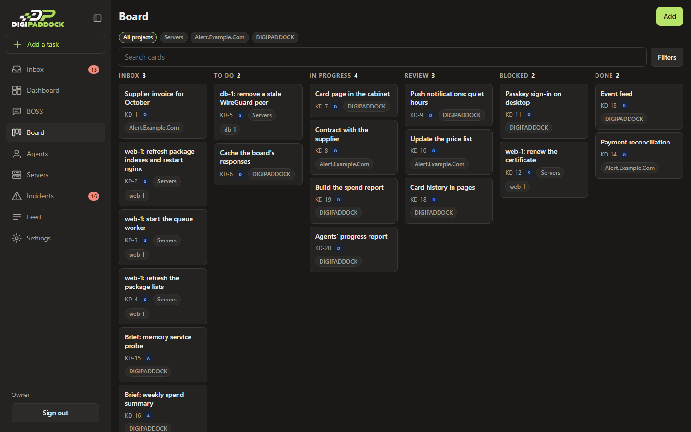

- **Card**: a compact header (more under «More»; its status chip changes the status by hand past the card's buttons, with a ready reason for the new status or «Other» with your own text; a duplicate may name its live original, and the card then shows «Duplicate KD-n»), the **next step** — what moves the card on and whose move it is — and five tabs in the address (`?tab=`):
  - *Discussion* — the thread: messages, agents' turns as one line per tool step, notices of services, decisions; an open decision stays under the last message, next to the input field. The thread loads its latest page and older ones on request. Compact activity blocks separate the agent's instruction selection and checked instruction delivery from Hindsight calls and their observed outcomes. The agent chooses compatible instructions itself; these blocks do not ask the owner to configure the work.
  - *Brief* — its versions and their differences.
  - *Result* — the outcome, links, criteria, review rounds, the last release.
  - *History* — every event, in pages.
  - *Sessions* — the agents' sessions on the card: each turn's command, steps, result, cost and the model that served it, as the usage ledger names it (`claude-opus-5-5`; a turn several models served names the costliest and «+N», all of them in the hint; a turn that reported no usage names none); to people who may steer the agent, a tool's output masked and cut to 4000 characters. «Stop» and «Continue» are here.

  The texts of a card — messages, the description, criteria, notes, results, questions — are shown as Markdown: headings, lists, tables, `code`, links; raw HTML is shown as text. Every agent's instructions tell it to write for that: technical names (paths, routes, fields, commands, codes, values) in backticks, several items as a list, a comparison as a table, a long text under headings. An agent passes a card's text as a command argument, where a `#` line after a line break is refused, so a heading there is a title underlined with `---`.

  A `mermaid` code block standing on its own in such a text is drawn as a diagram — a flowchart, a sequence of calls, a set of states: the analyst puts one into a brief where a flow is easier to see than to read, any agent into its turn's text (the dev's command guard refuses the block in a command argument). The drawing is made by Mermaid (`@mermaid-js/tiny`, MIT, pinned in `common/cabinet/web/package.json`) in a frame of its own, `/diagram.html`. Mermaid draws with inline styles, which the cabinet's Content-Security-Policy forbids, so the cabinet's policy stays as it is and the frame gets another: it is sandboxed — an opaque origin with no part of the cabinet's session, storage or API — runs its two scripts, loads nothing else, and is embedded by the cabinet alone. The page sends it the block's text and the palette and reads back a height. The service worker precaches neither the frame nor the library: they load where a text has a diagram. A drawing wider than the column shrinks to 0.6 of its size and then scrolls sideways; a block Mermaid cannot read is shown as its text with the reason. A text draws its first eight diagrams; further blocks stay code.

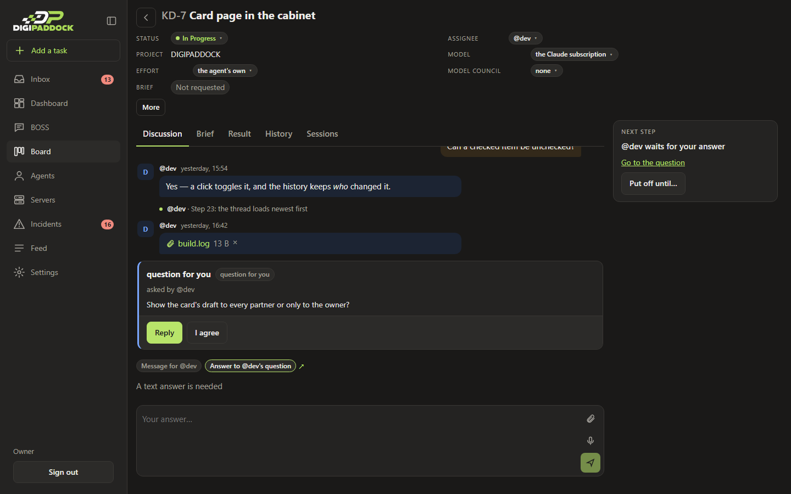

- **Agents**: every agent's state, its sessions and slots, and its chat. On a phone it is under «More» for whoever sees **Deploys**, which takes its tab. The sysadmin also has a «Monitor» thread for monitor events, and the coordinator one for its stall-detector ticks.
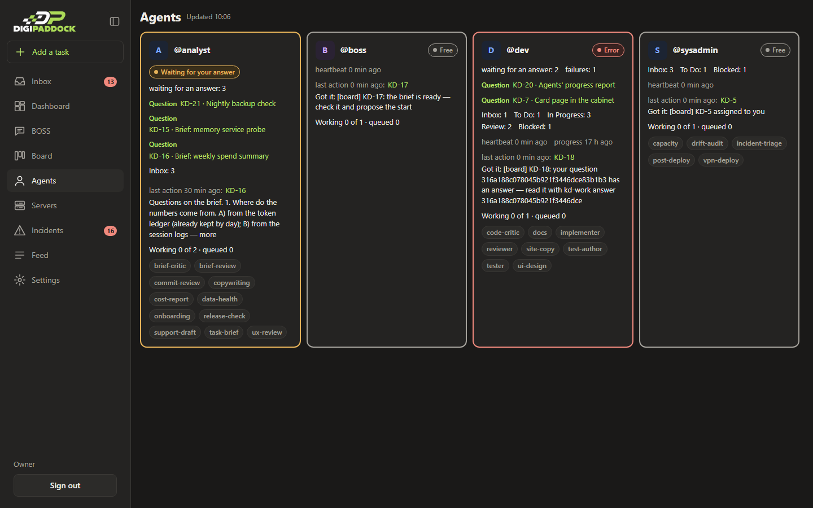

- **Feed**: the journal — what happened without a card: notices of services, sign-in codes, releases. No notification leads here.
- **Servers**: see below.
- **Deploys**: see below.
- **Settings**: notifications, devices, people and roles, projects, models (the subscription's and other providers'), the memory server's status.

Live screens refresh at most once a second and say how fresh they are; after a lost connection they show «Data may be stale · Retry» and keep the drafts you were typing. An open tab picks up a new release by itself: it checks for one when it comes back into view and every ten minutes, then reloads once onto it (drafts survive).

## Cards and decisions

The card's actions come from the board, not from the page: **Start** (Inbox → To Do, to the assignee or the project's route), **Write a brief** (the card goes to the analyst), **Accept**, **Return to work**, **Reopen**. A refused action says why (dependencies, a specialization the assignee lacks, no agent). Writing `@agent` in a message wakes that agent on the card. A person without `agents.control` on the project (a partner) reaches only the project's own agent and the card's: other mentions wake nobody, and another agent is not assigned; server labels need `servers.read`, and a parent or a dependency must be a card they see.

Decisions live in the card's thread and in the Inbox:

| Decision | Who asks | How it is given |
|---|---|---|
| Start a card the coordinator proposes; approve a brief | coordinator, analyst | «Approve» — it covers exactly the brief version shown; a newer version makes it stale |
| Allow the coordinator to split a goal | coordinator | «Allow», signed; «Revoke» on the same decision stops new subtasks |
| A sysadmin plan; a critical command | sysadmin | signed with a passkey, once per task or per exact command |
| A factory step (a reinstall, a component install) | developer | signed with a passkey |
| A pull request | developer | «Approve and merge», optionally «and release», signed with a passkey on its exact head; «Remarks» return it with text |
| An agent's question | any agent | the answer in the thread — a form of choices, text, files or a voice message |

A signature is checked again by the executor that acts on it, never taken from the page.

An agent's question form (1–8 questions) is shown by its length (`common/cabinet/web/src/lib/questions.ts`, `SHORT_MAX = 3`): one to three questions as one list with «Send the answers»; four or more one question at a time, then a review of every answer, where each can be changed, before sending. «Next» and «Back» only move inside the page — the draft is kept in the browser, no model is called and the agent learns nothing until the answer is sent. The answer goes whole, in one piece, and wakes the agent once; if the agent needs to ask more, that is a new question in its next turn.

A card whose [council of models](#the-council-of-models) names critics carries the chip “Model council”, and each gathering
is one block of its thread. It touches two of the decisions above: a brief under its council may be approved early —
the page says the council has not finished, and the approval cancels it — and a pull request's decision appears only
when its council ends; until then the council's block shows the pull request itself.

A coordinator's proposal shows «Approve» only while the board would take it: the page asks the approval's own checks (the proposal's term, the card's revision, title, project and assignee, the coordinator's channel). While a release reinstalls the coordinator its channel is off for a few minutes: the proposal says so instead of offering «Approve», reads itself again every 30 seconds and offers it once the coordinator is back. A refused approval names its cause — the coordinator is off, the proposal expired or changed, the card or the project's route changed — never only «the card changed».

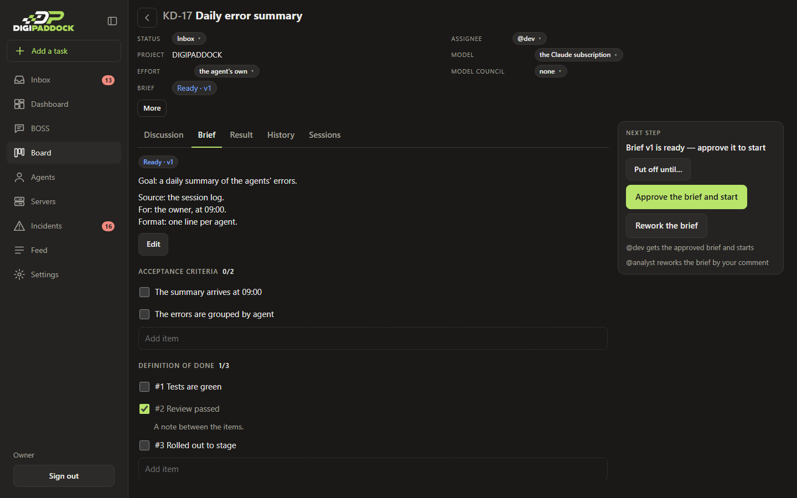

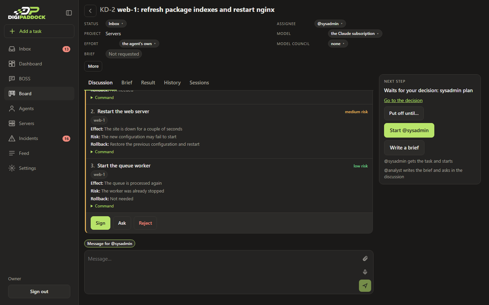

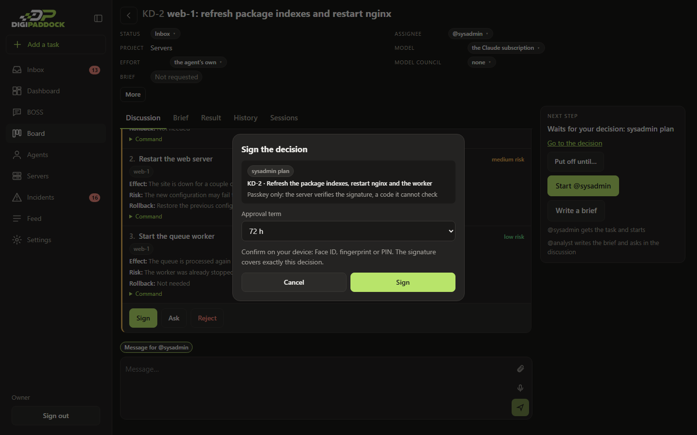

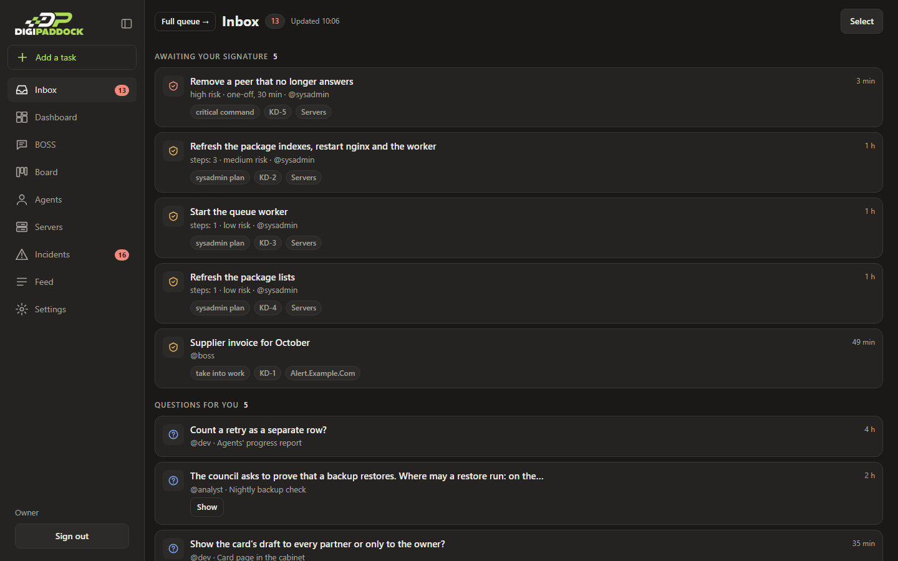

On a phone the side menu becomes a tab bar; the same screens fit 360 px:

  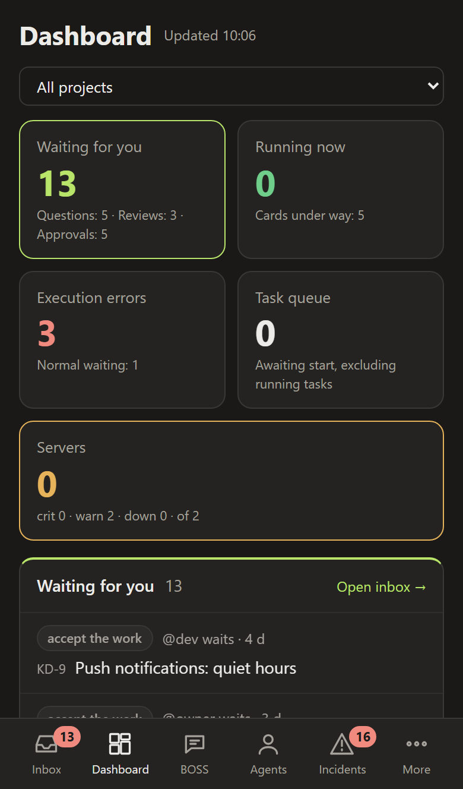
  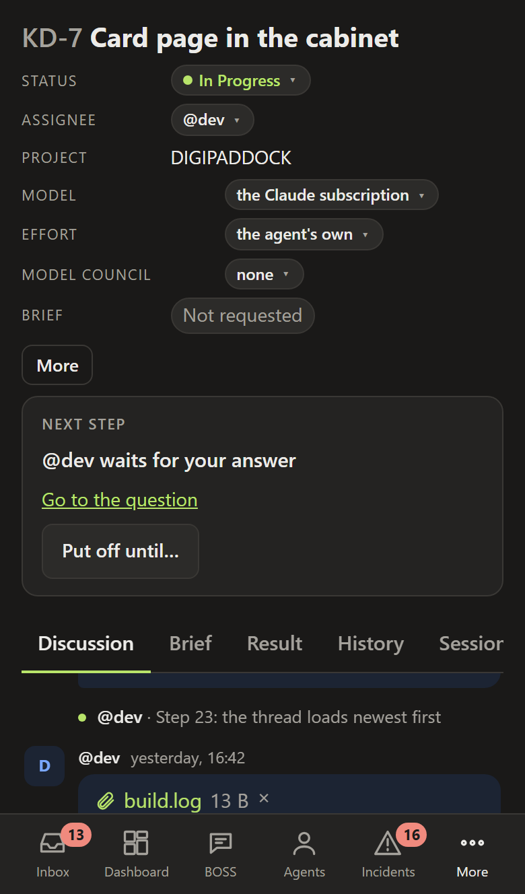

## Projects and repositories

A **project** is a board grouping with a **route**: the agent (or the owner) a new card of the project goes to. The owner creates, renames, reroutes and deletes projects in Settings → Projects; agents read them with `kd-task projects`.

A project's repository is attached in the same place by its `owner/repo` name. The cabinet checks the form, records the request, and a root unit on the host attaches it with the developer's account: attached, no access for the developer, no deploy key, refused because the repository carries hooks or an MCP config, or an error — the result shows on the project. Detaching keeps the clones; a project that releases to the host cannot be detached or moved to another repository from the cabinet, and the release flag is never set from there.

The repository's **passport** says what the developer and the factory may do with it: the base branch, the target branches a pull request may go into, the required checks, whether a merge needs the branch current with its target, and whether a merge may release it. Root sets it on the host (`add_repo.sh … --base --targets --up-to-date`); the card's pull request block shows the target, its effect and the checks. A project's cards share its memory bank ([Hindsight settings](hindsight-settings.md)).

## Models and providers

By default every session runs on the host's Claude subscription, on the model its agent is set to. The owner can put
a card, or a whole project, on **another model of the subscription**, or add **models of other providers** in
Settings → Models (three tabs: the models, the provider keys, a new model; the tab is in the address) and put it on
one of those; the choice is a spend decision, so it needs the `settings` right.

- **Models of the subscription** are a fixed catalog in the code (`common/coordination/claude-models.json`: Opus,
  Sonnet, Haiku, Fable), each named `claude:<alias>`. They come first in Settings → Models and in every model menu
  («Claude Opus · subscription»): probed like any model, never changed, disabled or deleted. A session on one starts
  with only `--model <alias>` on the host's subscription token — no provider key and no provider variables — and its
  usage stays with the subscription's, under the model names Claude Code reports. Which model an alias resolves to
  is Claude Code's to decide, so the cabinet keeps the name each alias served last — taken from a session's turn on
  that model, a critic's job or a successful probe — and shows it: the version in the model's title wherever a
  model is chosen or named («Claude Opus 5.5 · subscription»; a name that reads as no version is shown whole, in
  brackets) and the full name in Settings → Models («now served by `claude-opus-5-5`»). Until the first such run
  the title carries no version; a session on the agent's own model tells nothing about an alias.

- **Providers** are a fixed catalog in the code (`common/coordination/llm-providers.json`): the Anthropic API, the
  OpenAI API, OpenRouter, Fireworks, DeepSeek and one custom Anthropic-compatible endpoint (`https://` only). Each kind has its own key file on the host. An owner with `settings` can save or delete
  it on the **Provider keys** tab of Settings → Models (a model without its key links there), confirming each change with a passkey enrolled by root for this
  purpose. Partners and viewers cannot change keys; TOTP is not a substitute. The field is never prefilled and is
  cleared after an attempt. The root service verifies the signature itself and uses the same atomic writer as
  `kd-secret put llm-<kind>` (which remains available to root). The feed records provider, action, actor and time,
  never the key. See the [key runbook](model-provider-keys.md) for signer enrollment, revocation and recovery;
  the cabinet shows only whether the key is there, never its content. The keys tab also has a replacement-only
  **Claude subscription** block with age, estimated expiry and a probe, and separate **Anthropic API** and **OpenAI API**
  credentials for metered usage. Direct OpenAI models run through the local Responses transport described in the runbook.
- **A model** is the owner's slug (`or-gpt5`), the provider, the model's name at the provider as it is (`[1m]`
  included), a title, four prices per million tokens (input, output, cache read, cache write) and a context size.
  The slug is fixed at creation: usage is recorded under it. A model whose name is not a Claude is marked
  *experimental* — agents' tools may work worse on it. «Probe» runs a one-word prompt on the model through the session
  host and records the answering model and its latency, or the failure.
- **Where it applies.** The card's model, else the project's default, else the agent's own on the subscription — for every agent's
  session on the card and for its worker jobs; sessions without a card (an agent's chat, signals) stay on the
  subscription. The card's header carries the chips «Model» and «Effort»; the session's own values show in the
  *Sessions* tab, and the snapshot agents read (`kd-task view`) names them.
- **Effort** is the second chip: one of Claude Code's levels (`low` … `max`), on the card, else the project's, else the
  agent's own; it works on the subscription too.
- **Switching** takes effect on the next turn: a running turn finishes on the old model, an idle session restarts on
  the new one with its history; the thread names the model and effort each process starts on. A model that rejects
  the carried history (a non-Claude one may answer 400) gets one fresh start without it, and the thread says so; any
  other failure of the first turn (an overload, a timeout) keeps the history.
- **Refusals, never a silent fallback.** A disabled model, a provider without its key on the host, or a session host
  not yet restarted after a release fails the card's command with the reason and a notice to the owner; a key file
  gone between the delivery and the start fails the session the same way. The chips warn about a disabled model or a
  missing key ahead of time; a model of the subscription needs no provider key.
- **Councils.** A critic of a [council](#the-council-of-models) is any of these models — one of the subscription
  or an enabled model of a provider; the same refusals apply, and a model that cannot run fails that critic's run,
  never the card's session.
- **Cost** of a provider's model is counted under its slug, priced by its own table; the Agents page and `kd-usage`
  show it next to the subscription's models. Its cache read and cache write columns are token sums over every model
  request, not the size of a conversation; how the prompt cache differs from a session's history is in
  [Session lifecycle](architecture.md#session-lifecycle).

## The council of models

A **council** is the set of models that criticise a card's brief and its code before the owner reads them. Both
gather by themselves: the brief's at the analyst's hand-in, the code's when the developer publishes a pull request
(below).

- **What is set.** Per kind — the brief, the code — the critics: any enabled model, of the subscription or of a
  provider; a model named twice reads twice, independently; at most 10. With them the rounds the council may take
  (1 to 5, 3 by default) and, for the code, the least diff in changed lines that gathers it (100 by default; 0 —
  every pull request). The limits are `common/coordination/council.json`.
- **Where.** A project holds the default of its cards (Settings → Projects); a card its own — the “Model council”
  chip in its header and in the new card's form. A kind the card names wins over the project's, and «no council» on
  the card switches that kind off for it whatever the project says.
- **How.** The critics of a kind are picked from the list of models with search, several at once: the list stays
  open, a model picked again is one more read, a chosen one is taken off by its «×». Where the project names no
  critics for the kind, the card's are picked straight away; where it does, “Composition” chooses first — the project's,
  the card's own, or no council.
- **Who.** A council is a spend decision: setting it needs `settings`. Everyone who sees the card reads it, no agent
  sets it, and the snapshot agents read (`kd-task view`) names the council in force. Critics for the code are
  accepted only on a project that has a repository on the host and whose developer has a worker pool: the cabinet
  refuses the composition otherwise and says why.
- A model a council names is not deleted while it is named. Disabled, it stays that council's critic until the
  owner removes it — the rest of the composition is edited as before — and is only not added anew.

### A brief under its council

- **The gathering.** The analyst's hand-in (`brief-ready`) of a card whose council names critics for the brief
  starts round 1 over that version. A version a person saved gathers nothing: the owner reads it anyway. Each critic
  is a worker job of the analyst's pool — the `brief-critic` specialization, read-only — on the critic's own model,
  whoever holds the card by then. These jobs have their own day limit (`jobs_per_day` in `council.json`), apart from
  what the coordinator may order.
- **What a critic reads.** A worker has no board and no network, so the cabinet gives each critic the card as files
  in its slot's `inputs/` folder, written for that round: the brief of exactly that version, whole; the card's
  thread (its newest messages when it is long); the cards the brief names; from the second round, the earlier
  findings with the analyst's answers — the latest round first and as full as fits. When that record is over its
  part an older round gives way, never a finding cut in the middle: its minor findings, then all of them, become
  one line each (the id, the weight, where, the beginning of the scenario, the answer with its reason), and at
  last the round is only counted; each older round keeps a line per finding before another is given in full. The
  round's line says what was folded. The repositories it reads itself. Its result is data — a verdict, findings
  (`critical`, `major` or `minor`: where, the evidence, how it fails, a recommendation), questions for the owner
  and the inputs it missed. It writes nothing on the card.
- **The round's end.** With nothing above `minor` and no question the council is over (`clean`). Otherwise the
  card returns to the analyst — as “Rework the brief” returns it — with one command. The analyst reads the record
  (`kd-work council KD-n`) and answers every finding with `kd-work council-reply`: `fixed`
  (the brief changed), `rejected` with the reason, or `later` on a named card with the reason. Only a `critical`
  or a `major` finding without an answer holds the handoff; a `minor` one is answered all the same, so that each
  round shows what was taken and what was not, and `council-reply` names the minor ones still left. A critic's question
  only the owner can decide reaches him as the analyst's question. A changed brief handed in again is the next
  round; the same text with every finding rejected or moved ends the council (`settled`). The rounds are limited:
  past the last one the council is `limited` and the owner decides with what is left open. An aggregate in work —
  a card with stages whose plan the analyst writes anew — is not taken from its holder: only its `brief-ready` is
  taken back and the analyst woken, and the analyst answers and re-plans without holding the card. A wake still
  queued when the council is cancelled, ends or goes to its next round is dropped (`council_moved`).
- **While it reads.** The brief's state is “in council” (`in_council`): its start is not proposed and the stall
  detector's `brief_ready` is silent; the council's end tells the coordinator. A brief with a council never starts
  by itself, whatever its size: after the critics it is the owner's to start. “Approve the brief and start” stays
  available with the warning “council still running: round 2 of 3” — using it cancels the council. A person with
  `settings` on the project may cancel it (“Cancel the council”); removing the brief's critics from the card, moving
  the card out of Inbox or closing it ends it too.
- **On the card.** The thread shows one block per council in place of the critics' separate messages: the rounds
  (the current one open, an earlier one folded), and in a round each critic as a card
  of its own (model, the model that served its read as the usage ledger names it, verdict, counts, cost; a
  critic on the writer's own model is marked) with its findings, the gravest first. A finding's row says what goes
  wrong, with where under it (“Where”); its weight and the writer's answer are icons — fixed, rejected, later, no
  answer yet. The writer answers every finding of the round; a minor one holds nothing, and one left without an
  answer carries no answer mark — as do the findings of a round that found nothing above minor: it ends the
  council, and nobody is asked to answer them. Opened, the finding names its weight and id and gives the evidence, the
  recommendation and the answer in words. The writer answers a round on that round's own findings, so a round's
  line, folded or open, counts what its critics found by weight and, beside it, what became of that: how many
  findings the writer fixed, rejected, moved to later, and how many still wait for an answer.
  “Legend” at the block's foot explains the icons. A critic's questions are listed apart from what it
  had no access to (“Missing for the review”). «Next step» names who is waited for, the “Brief” tab the round each version
  went through, and the snapshot agents read (`kd-task view`) the line `council round: brief 2/3 running`. An
  agent waits for a round's end with `kd-work finish … --outcome wait_dependency --council <id>`. The coordinator,
  who holds no `kd-work`, reads the same record with `kd-boss-board council --card KD-n`.
- **Problems.** `council_run_failed` — one critic did not read (no slot, a model without its key, a result that is
  not the specialization's or is over 64 KiB, a brief over what a critic is given); the round goes on with the
  others.
  `council_failed` — no critic could start: the brief goes on without a council and the owner gets a notice.
  `council_stalled` — the analyst has not answered the findings for over an hour; its open question to the owner
  pauses that clock. `council_unanswered` — a hand-in past unanswered `critical` or `major` findings: refused where
  the pipeline enforces. Where it observes, the hand-in stands: a changed brief is the next round, and the same
  text ends the council with the findings open (“the writer handed the brief in past the findings”) — the problem stays for
  the coordinator and the owner until the work starts.
- **API.** `GET /api/cards/<id>/councils` — the card's councils with their rounds and whether the reader may
  cancel one; `POST /api/cards/<id>/councils/<council>/cancel` — `settings` on the card's project;
  `GET /api/cards/<id>/councils/<council>/diff` — the diff of the pull request a council of the code stands on.

### A pull request under its council

- **The gathering.** `kd-forge publish` of an open pull request on a card whose council names critics for the code
  starts round 1 over the published head — when the pull request changes at least `min_lines` lines of code
  (additions and deletions; tests, `docs/`, `*.md` and message catalogs do not count). A smaller one gathers nobody
  and its decision says “council review: not required”. Each pull request of a card has its own council. A head whose
  decision already stands — opened before the critics were named — gathers nobody: the council reads from the next
  head on.
- **The decision is held.** While the council is open the head has no decision: nothing of the pull request is in
  the owner's inbox and no “PR awaits a decision” is sent. The council's block shows the pull request meanwhile — its
  target, effect and checks, its files, the cage and the diff — with nothing to decide. The same head published
  again keeps the hold, and what is held is its newest publish (the checks, the effect). The decision opens — with the target, the effect and the
  checks of that publish — when the council ends, however it ends: `clean`, `settled`, `limited`, `failed`, or
  cancelled by the owner or by taking the critics off the card. Holding the decision back is all a council does to
  a pull request: it approves nothing and merges nothing. A pull request merged or closed, in the cabinet or in the
  forge, or published under another card's title ends its council (`pr_closed`); so does closing the card
  (`card_closed`) — and nothing opens.
- **What a critic reads.** Each critic is a worker job of the developer's pool — the `code-critic` specialization,
  which writes nothing — on the critic's own model, counted under the council's day limit. The runner prepares the
  project's copy on exactly that head: the branch `pr-head` checked out, `pr-base` at the tip of the target branch,
  no remote. The critic reads the diff and the code around it itself, with the card (`inputs/card.md`) and, from
  the second round, the earlier findings with the developer's answers (`inputs/council.md`); it runs nothing. The
  host's copies get the heads of pull requests from `kd-repo-sync` (`refs/pull/*/head`). A head the copy has not got
  yet is waited for — a new job every two minutes, for at most `head_wait_minutes` of `council.json`; a try that
  met no head ran no session and does not count under the day limit — and then fails that critic's run
  (`head_missing`).
- **The round's end.** With nothing above `minor` and no question the council is `clean`. Otherwise it waits for
  its writer — the agent that holds the card, never the coordinator or a person; the card itself is not touched. A developer whose turn waits for the
  council (`kd-work finish … --outcome wait_dependency --council <id>`, the line `kd-forge publish` prints) is
  woken by that wait's end: one continuation, within the continuations' limits; otherwise — and where the pipeline
  only observes — by the council's command. It answers every finding with `kd-work council-reply`; only a
  `critical` or a `major` one without an answer holds the hand-in. A new head published is the next round; a round a new head interrupts is cancelled and
  counted; a head past the last round ends the council (`limited`) and the decision opens on that head, saying
  “out of rounds”. Every
  finding rejected or moved and the turn ended (`wait_user`, Review, Done) settles the council on the head it read
  (`settled`): the owner decides with the reasons beside the findings — unless the developer's own question to the
  owner is open, which comes first. «Fixed» with no new head is not handed in: Review, Done and a new wait for the
  council are refused until the head is published.
- **On the card.** The council's block names the pull request (“Council · code · PR #N · round R of M”) with a link to
  the forge, and the head each round read. The pull request's decision says how the review of its head ended —
  “council review: clean”, “rejected by the writer: K”, “out of rounds”, “did not run”, “cancelled”, “not required” —
  with a link to that block; a card without critics for the code has no such line. «Next step» names the round and
  who is waited for, and the snapshot agents read the line `council round: code 1/3 running, … · PR #N head …`.
- **Problems.** The same four. `council_failed` — no critic could start (no free slot is not a failure; no pool, a
  model without its key is): the decision opens and the block says nobody read. `council_stalled` — the card's
  holder has not answered for over an hour; a person or the coordinator holding the card answers no finding, and
  the problem names that holder: the card goes back to the developer, or the owner cancels the council. `council_unanswered` — Review or Done past unanswered findings, or past
  «fixed» with no new head, where the pipeline only observes; where it enforces, `finish` is refused. A decision that could not open
  at the council's end is said to the owner in the card's thread: the next publish of that head opens it.

## Plans in stages

A large brief is written as stages; the owner's one approval creates a card per stage under the brief's card, which
becomes the plan's aggregate and shows the stages with their states. A stage that depends on another waits for it.
In a plan with stages of several roles or projects every stage is a card like any other: its own pull request, its
own Review and the owner's acceptance.

### A chain plan

A plan whose stages are all of one role in one project with a connected repository — and that role is the agent
leading the plan — runs as a chain, so that the work does not stop at the owner after every stage. The approval
button says so before he presses it — judged by the agent the start hands the card to, so a brief the analyst
still holds says it too — and the plan's block is headed “Chain plan: a branch and a pull request per repository,
one acceptance”. A plan is a chain from its first approval and stays one; a new version of its brief may not add a
stage of another role or project.

- **A branch and a pull request per repository.** The stages run strictly one after another, each on the commits
  of the one before. The stages' cards are of one project, but their work may reach any repository the agent has:
  in every repository the stages commit into, the plan has one branch and one pull request of the plan's card — no
  stage opens a pull request of its own. Every stage publishes its commits into the plan's pull requests when it is
  handed in. While a stage is still open that publish only records the head: no council gathers and no decision
  opens, and nothing is merged or rolled out before the plan's end — so no stage's criteria can need its change on
  a stand; the rollout and the checks on a stand are the brief's own criteria, met at the end.
- **The gate between two stages.** A handed-in stage is not among the owner's reviews. The cabinet orders a code
  review of the stage's own commits in every repository the stage changed — a read-only worker job of the stage's
  role on the card's model for each of the plan's pull requests whose head moved, from the head that pull request
  had when the previous stage was closed to the published one, under the cabinet's own daily limit of jobs — and,
  when all of them have answered, wakes the coordinator once with the worst of their verdicts. Each review's
  findings are a message in the stage's thread that names its pull request. The coordinator reads the stage's
  report against the stage's brief, never the code, and decides by a typed operation: **pass** (the stage is Done
  and the next one starts; only with a ready review, every open pull request of the plan on the head it was handed
  in on — none moved, opened or closed since — every criterion checked, nothing open on the stage and every earlier
  stage of the plan Done — otherwise the pass is refused and the coordinator holds the stage), **return** (back to
  the stage's agent on the reviewers' findings, twice a stage at most) or **hold** (the stage stays in Review and
  waits for the owner, with the coordinator's reason and a line in its chat). A stage that published nothing new is
  not reviewed; the coordinator passes it only when its report says it changed no code.
- **What the owner sees.** Each stage's line in the plan says where it stands: its review runs, the coordinator
  decides, passed, returned, or waiting for him with the reason. A stage reaches his Inbox, and a notice is sent, only
  when it is held — by the coordinator, or by the cabinet itself when the coordinator has not decided within 30
  minutes, is not available, or the review did not happen: it could not run, or a reviewer answered that it could
  not read the change (whatever verdict such an answer carries judges no code, nobody is woken with it, and the
  stage's other reviewers are stopped). He may
  open any stage and accept or return it himself at any moment. A stage the coordinator passed sends him no “done” notification: it is not work he accepted.
- **The end.** When the last stage is closed the plan's agent is woken on the parent card; the wake names the plan's
  open pull requests as `<project>#<number>` (by project and number, the repository where a pull request has no
  project; without any open, no list). It publishes the plan's pull request in every repository once more — now the card's council reads each and the owner's decision opens on
  each — merges them on his approval in the order the brief names, rolls the change out and hands the plan in. The
  owner signs one pull request per repository the plan changed and accepts one card. The rollout is one: “and
  release” ticked on any of the plan's pull requests means a release after the plan's last merge — the cabinet says so
  beside the tick, and the agent is told to merge them all first and release once. With the tick on none, the plan
  is merged and not rolled out.
- **A closed stage reopened.** Returning a closed stage to work raises a problem for the coordinator
  (`stage_reopened`): the later stages build on its commits, so it pauses the ones in work and tells the owner. The
  stage's next Done settles it.
- **The switch.** `"chain": false` in `/etc/digipaddock/pipeline.json` (root's file, set by hand; `pipeline_setup.sh`
  keeps it) makes the plans approved from then on plain ones; a chain plan already running stays a chain. Where the
  pipeline only observes, no plan becomes a chain.

## Servers and incidents

- **Servers** (`/servers`, `/servers/<alias>`): every managed server's checks with their levels, the week's status changes, its incidents and cards, and the trusted lists of the last check.

  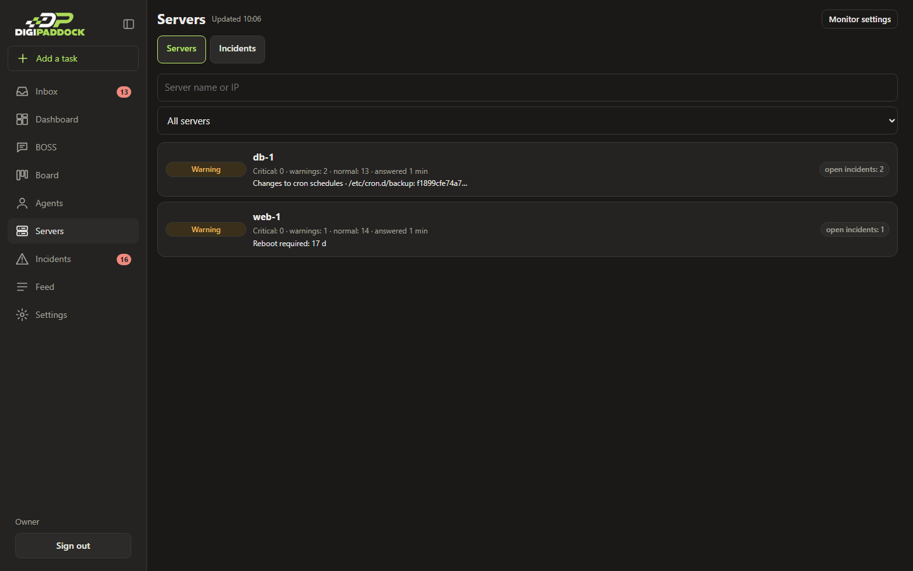

- **Incidents** (`/incidents/P-n`): the timeline and the linked cards. In the list (`/incidents`) each row names its server as a chip beside its P-n — a group, the servers of its members — so the same check on two servers never reads as one event twice. «Acknowledge», «Mute» for 1 hour, 1 day or 7 days, «Unmute». Above the list, «Platform alerts» holds what the platform says about itself with no card — a failed service, a release, a factory operation: the last week's, the older ones behind «Show older». It is there for people with the settings, and only once there has been an alert. An open critical incident that is neither acknowledged nor muted waits in the Inbox and in the Overview's problems. A difference from the baseline or an unknown login closes by the owner's passkey signature: “Accept into baseline” trusts the object; a login by a key whose access is already gone closes by “Access removed” — the monitor checks its latest snapshot of the server, refuses while any `authorized_keys` there still allows the key, and otherwise closes the incident without trusting the key, so its next login opens a new one. Several picked incidents are accepted or closed as “access removed” with one signature.
- **«Check now»** asks the monitor for one tick of that server only; one request per server at a time.
- **«Test critical alert»** (Servers → Settings) raises a drill incident on the monitor's next tick: the cabinet opens P-n and pushes it, the alert watcher duplicates it to Telegram, nobody is woken, and it closes by itself after three good ticks.
- Agents read the same through `kd-monitor-read`; only the sysadmin acts on the monitor, and trust, acknowledgement and muting stay with the owner.

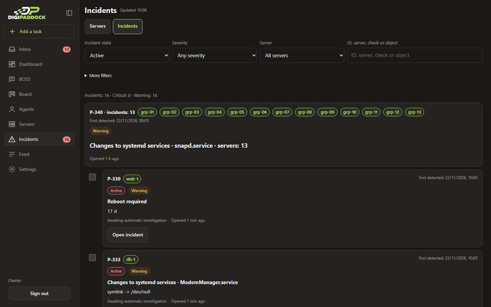

## Deploys

**Deploys** («Деплой», `/deploys`; on a phone in the tab bar, in the place of «Agents») is for the owner and people with `deploys.read`. Each project whose passport names its environments (`repo.deploys` of `host/projects.json`, [deployment-overlay.md](deployment-overlay.md)) has a panel with a row per environment in the passport's order, in fixed columns — a status or a button never moves the rest:

- the status of its last Forgejo Actions run (waiting, running, success, failed, cancelled) as a sign, a word and a colour;
- the commit of that run and how long ago it started; when the last run is not the one that runs there (it failed, it is still running), «running `<commit>`» names the commit of its newest successful run;
- how far it is ahead of prod: «+3 vs prod» — commits the environment runs that prod does not («same as prod» when none). Prod is the project's only manual environment, else the one named `prod`;
- «waiting to deploy: N» — commits of its branch's head that the environment does not run yet; on prod with none, «all deployed» — with its last run passed and no deploy under way the whole row turns green and the button goes grey (it still deploys again);
- the number of cards waiting for it;
- «checks failed: N» — listed commits (below) whose checks in Forgejo failed, so a commit that broke its tests is seen before anyone deploys it.

A row opens its details: first the commits behind its counts — «Not deployed to prod: 3», «On test, not on prod: 3» — the newest 20 of each, a commit a line with its title, its hash linking to the commit in Forgejo, its author and when it landed on the branch (the committer's time), its checks — a sign for their worst state (passed, running, warning, failed) and each check that did not pass with a link to its log — its description under the title on a tap and «…and N older» past the listed ones; then the branch and its head, the run (who started it, the inputs of a run started by hand — `confirm`, `skip_tests` — and its log in Forgejo), the run that runs there, the waiting cards and the last launch from the cabinet. A project whose read failed, or was not read well for two minutes, says under its name since when there is no fresh data from Forgejo («nothing read from Forgejo yet» when never) and the reader's error. The platform's own release has a panel of its own — its revision, state and the card it came from; a release is healthy by its health check's notice, whatever order the forge's «released» notice comes in.

The cabinet has no network and holds no Forgejo token. A timer under the Forgejo executor's user (`digipaddock-deploys.timer`, every 45 seconds, installed with the dev role) reads each environment's latest 20 runs of its own workflow with dev's read token, page 1 named (without it Forgejo ignores the limit and sends the workflow's whole history; an answer longer than 20 is cut, a project keeps its newest 100 runs — the cabinet refuses a report with more), and reports them to the cabinet, which keeps every run it has seen. The same read measures each environment: its branch's head (`/branches`; a branch the repository lacks leaves it unknown) and the counts above with their commits: one page of the commits list between two commits — its newest 20 (no diff, files or signature check computed) and its `X-Total-Count` for the count; a range two environments share is asked once, at most 20 ranges per tick, an unanswered one is unknown and shows nothing. A commit's title is its message's first line, its description the rest, cut at 1000 characters. A listed commit's checks are Forgejo's combined status of it (`/commits/<sha>/status`: the Actions jobs and any other status a forge posts), one request a commit, a commit in two lists asked once, at most 40 per tick; an error counts as a failure. What an environment runs, for the counts, is its newest successful run among those 20. The **Journal** is folded under «Show the journal»: one line per run, newest first, 20 at a time with «Show more», the platform's releases among them, filtered by project and environment.

### Waiting for a deploy

An agent whose merged work deploys by itself ends its turn with `kd-work finish KD-<n> --outcome wait_dependency --deploy <project>:<env>[@<sha>]`. Without a commit the wait names the head of the card's last merged pull request in that project: a merge is a merge commit, so every later commit of the branch holds that head. A project or environment the page does not list is refused. Each environment's chip counts the cards waiting for it and opens their list.

The newest finished run of the environment that holds the commit decides: its own commit, or one whose ancestors hold it — for the commits the cards wait for the reader asks Forgejo (a compare of the two, at most 20 per tick) and reports the answer with the runs. A successful run wakes the card. A failed one wakes it too, «without the answer it needed», with the run's number and log; the card's thread gets a notice, and the run goes to **Inbox** under «Failed deploys» for everyone with `deploys.read` until one of them presses «Got it». A cancelled or skipped run decides nothing: the wait goes on. An environment the passports no longer name leaves the wait for routing. A prod wait has no deadline.

### Deploy to prod

An environment that runs only by hand (`manual: true` in the passport — the prod of `alert` and `api`) has the button **Deploy to prod**, shown to the owner alone: a person holding every permission over every project. Anyone else, `deploys.read` included, gets no button, and the server refuses the request. The button opens a sheet that names the commit that goes out (the branch's head as the reader last saw it) and the new commits it brings against what prod runs, listed as in the row; the owner ticks «Skip the tests» where the workflow takes that input (`skip_tests: true` in the passport, off by default) and presses «Deploy» — the passkey is the whole confirmation, no word is typed. The sheet warns when commits that go out failed their checks. While a deploy is under way the button reads «Deploying…» and waits: from a launch kd-review dispatched (or whose answer was lost) until the reader shows a run of its commit — at most 15 minutes when Forgejo never ran it — and while the environment's last run waits or runs. The server refuses a second launch the same way (`conflict`, reason `deploy_running`) before it asks kd-review anything, from any tab or device.

This signature — `deploy_prod` — is the cabinet's only one without user verification: the browser is asked with `userVerification: discouraged`, so a saved passkey on a desktop signs without a fingerprint or PIN (the owner's choice; a browser may still ask for its PIN, and that is then kept). Every other decision, sign-in and step-up still requires user verification. The signed value (`kd.deploy_signature`) binds the launch's own id, the project, repository, environment, workflow, branch, the commit at the branch's head when the sheet asked, `skip_tests`, the person, a term of ten minutes (the approver takes no longer) and a nonce. A launch that Forgejo did not take (an error, no answer) is signed again: the nonce is spent before the call, so a signature never starts two deploys.

The cabinet has no Forgejo token. It asks kd-review — the approver that holds its own token — for the branch's head, checks the assertion against the person's own key and hands the launch to kd-review, which checks it again against its registry of the owner's signing keys (`kd-signers sync --apply`), spends the nonce, reads the environment from the passports of the release tree and refuses when the branch's head is no longer the signed commit; only then it calls Forgejo's `workflow_dispatch` with the passport's inputs (`confirm` gets `deploy`, `skip_tests` the owner's choice). A forged or replayed signature, another commit, or `skip_tests` where the workflow has none start nothing. Each launch — started or refused, with its commit and `skip_tests` — is recorded (`deploy.launched`) and shown under its environment; the run itself comes with the reader's next read, its inputs in the journal. There is no rollback button: a rollback is a new deploy of an older commit, outside the cabinet.

## Notifications

Web Push to each signed-in device, by rules per kind and level, with quiet hours, and a morning digest. A notification opens the place it is about, never the feed: a card or a decision, an agent's chat, an incident; the half-hour «Updates» its one card or, with several, the board; the digest the overview; an «Alert» or «Attention» without a card the platform alerts on the incidents page. A failed agent session and an agent's message in its chat are pushed at once. The push sender is a separate user that alone holds the private key; stopping it only queues the notifications.

## Voice

A voice message — recorded with the button or attached as a file — in a card's thread, an agent's chat or «Monitor» is transcribed on the host by a one-shot process without network, in the author's language. Under the recording it shows «queued: N», «transcribing», the text or an error; the agent sees the text as a line `[голосовое, расшифровка] …` under the file and is woken once the message's recordings are done. A failure offers «Retry» (or asks to record again when the recording is too long, too large or empty). Setting `"transcribe": false` in the cabinet's configuration and restarting the service turns recordings back into plain files.

## Command line

The host-side program `kd-cabinet` — reading and editing cards as root, people and their signing keys, releases and health, factory operations, the service commands — is listed command by command in [cabinet-cli.md](cabinet-cli.md).
