# Features

What DigiPaddock does, with pictures of the owner's cabinet. The pictures are of the development cabinet over its
synthetic seed (`kd-cabinet serve --dev --seed`; the agents there are scripted). `npm --prefix common/cabinet/web run
screenshots` takes them again. Each section links to the document with the details.

- [A team of agents on one host](#a-team-of-agents-on-one-host)
- [One board for all work](#one-board-for-all-work)
- [Clarify before building](#clarify-before-building)
- [Long work in stages](#long-work-in-stages)
- [Approvals signed with a passkey](#approvals-signed-with-a-passkey)
- [Everything that waits for you, in one place](#everything-that-waits-for-you-in-one-place)
- [From a card to a release](#from-a-card-to-a-release)
- [Servers and incidents](#servers-and-incidents)
- [On the phone](#on-the-phone)
- [Limits that do not depend on the model](#limits-that-do-not-depend-on-the-model)
- [Memory](#memory)
- [A new agent without new code](#a-new-agent-without-new-code)
- [Install, release, roll back](#install-release-roll-back)
- [Cheap when idle](#cheap-when-idle)
- [Try it](#try-it)

## A team of agents on one host

Each agent is a Claude Code session with its own Linux user, its own chat in the cabinet and a narrow set of powers.
The team today:

| Agent | Job |
|---|---|
| **analyst** | Clarifies a task with the owner and writes a brief with acceptance criteria before anyone builds it; also copywriting, UX review, release checks, support drafts |
| **boss** | The coordinator: routes cards, notices stalled work, passes handoffs, gives directives, splits a goal the owner allowed it to split. Approves nothing |
| **dev** | Implements cards in its own worktree, opens pull requests, merges and releases after the owner's signed approval |
| **sysadmin** | Watches the server fleet through a read-only gateway, changes servers only under a plan the owner signed |
| **workers** | Short-lived sessions of an agent for one specialization (implementer, reviewer, tester, docs…) on one card, in prepared slots |

The Agents page shows each agent's state from facts — working, waiting for your answer, queued, free, error — what
waits for you, its failures and its last action; each agent has a chat.

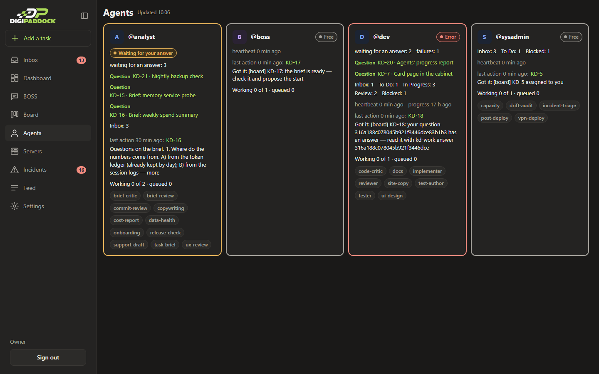

Details: [roles and flows](roles.md), [team model](team-model.md).

## One board for all work

Every piece of work is a card, created before the work starts, with statuses tools rely on: `Inbox`, `To Do`,
`In Progress`, `Blocked`, `Review`, `Done`. Agents claim cards and report on them through one executor that checks
the caller, the card and the transition; only the owner (or the coordinator within a goal the owner granted) starts
work from `Inbox`.

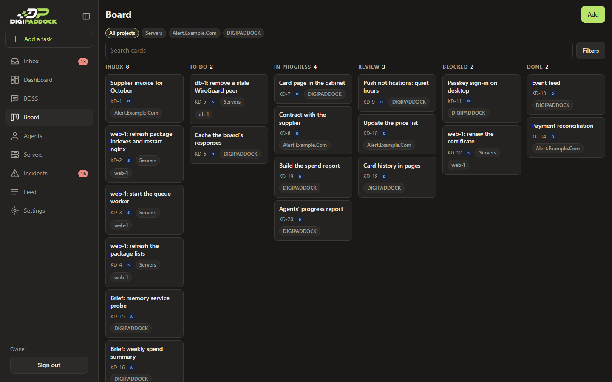

A card is a conversation: its thread holds people's messages, agents' turns as one line per step, decisions and
notices; *Brief*, *Result*, *History* and *Sessions* (each turn's steps, cost and masked tool output) are tabs beside
it. The **next step** says what moves the card on and whose move it is. Writing `@agent` wakes that agent on the
card.

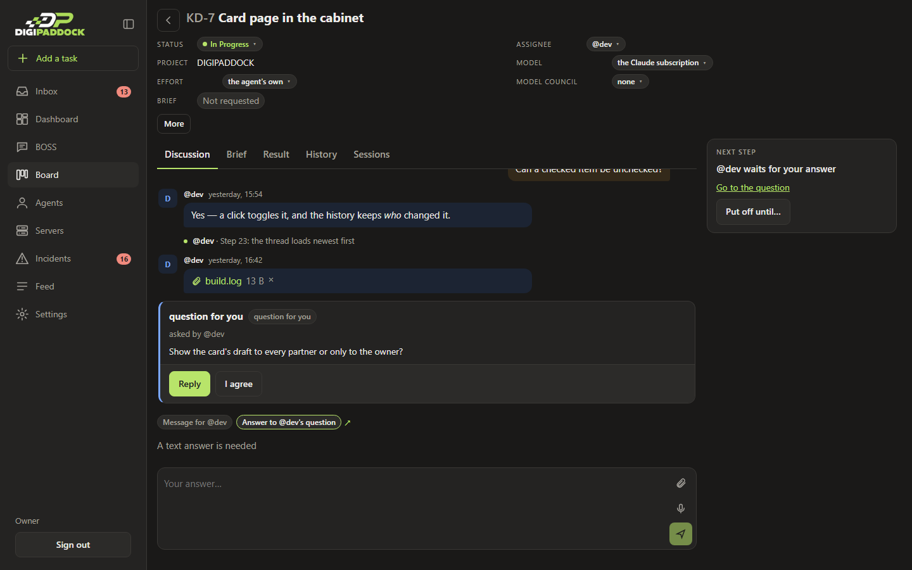

Details: [cabinet](cabinet.md#screens).

## Clarify before building

An unclear task is settled in a dialogue before code is written. The analyst asks its questions in the card's thread
— as forms with options and a recommendation where there is a choice — sums up what it understood and writes a brief:
goal, scope, approach, risks, acceptance criteria, size. The owner's approval covers exactly the brief version shown;
an edit after it makes the approval stale. A large brief is written as stages, and one approval creates a card per
stage — see [Long work in stages](#long-work-in-stages).

A brief may first go to a **council of models**: the critics the owner chose for the card or its project each read
it on their own model, the analyst answers every substantive finding — fixes the brief, or says why not — and the
owner reads the brief with the findings and the answers beside it. A pull request goes to its council the same
way: the critics read the published head, the developer fixes or answers every substantive finding, and the
owner's decision opens only when they are done — with how the review ended beside it. The council approves nothing
and the rounds are limited; see [the council of models](cabinet.md#the-council-of-models).

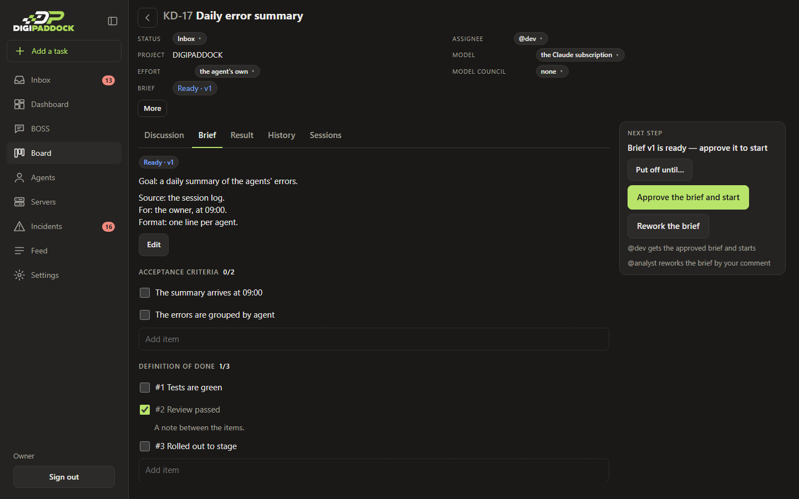

Details: [the analyst](roles.md#analyst-analyst).

## Long work in stages

A goal too large for one card runs as a plan of stages under one approval. The approval creates a card per stage
under the brief's card, which shows every stage with its state; a stage that depends on another waits for it.

When every stage is the same agent's work in one project, the plan runs as a **chain**, one stage after another,
without stopping at the owner after each:

- **One branch and one pull request per repository.** Each stage builds on the commits of the one before; whatever
  repositories the stages touch, each gets one branch and one pull request of the plan, and nothing is merged or
  rolled out before the end.
- **A gate between two stages.** A handed-in stage is read by a code reviewer — a read-only worker on the stage's own
  commits in every repository it changed. The coordinator weighs the reviewer's verdict and the stage's report
  against its brief and decides by a typed operation: **pass** (the next stage starts), **return** (back to the agent
  with the findings, twice at most) or **hold** (it waits for the owner, with the reason). A pass is refused while
  anything is open: an unchecked criterion, a moved pull request, an earlier stage not done.
- **The owner is asked only when it matters.** A stage reaches the Inbox only when held — by the coordinator, or by
  the cabinet when the coordinator has not decided within 30 minutes or the review did not happen. The owner may
  open and accept or return any stage at any moment, and at the end decides on the plan's pull requests and
  accepts the whole once.

Details: [cabinet: plans in stages](cabinet.md#plans-in-stages).

## Approvals signed with a passkey

The owner approves tasks, not keystrokes. Reads and local work in the sandbox need no approval; a card's start is one
click; the risky steps are decisions signed with the owner's passkey and checked again by the executor that acts on
them — never taken from a chat message a model read as «yes».

| What | Approval |
|---|---|
| A sysadmin plan: servers and typed operations | signed once per task, for a term |
| A rollout after a merge: the project's own tools, switches, a reload | the sysadmin's plan, asked for by the developer — signed like any plan |
| A plan made only of a test environment's own steps | approved by the cabinet's rule, no signature; the server checks each step against its own list |
| A critical server command | signed once per exact command, valid 30 minutes |
| A pull request | signed on its exact head with a mode: approve, merge, merge and release |
| A factory step: an agent's reinstall, a component install | signed |
| Letting the coordinator split a goal | one click, revocable |

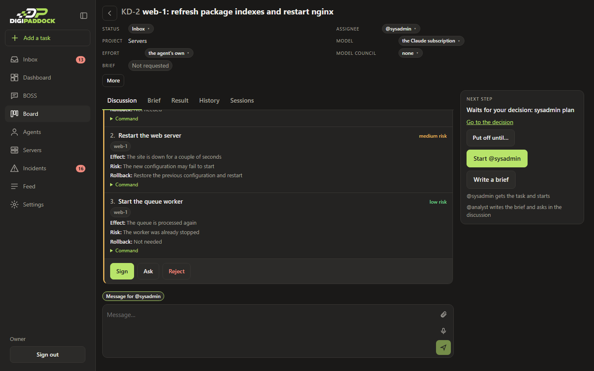

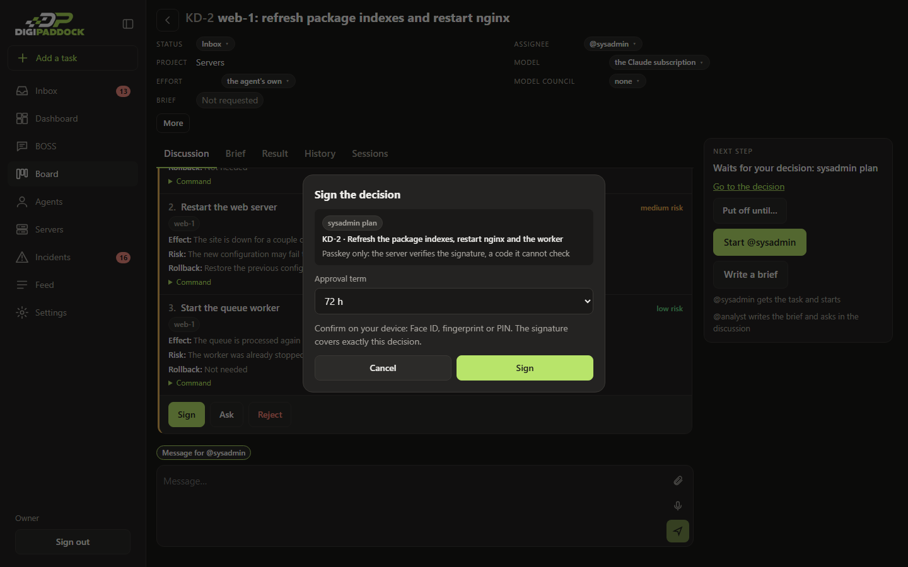

Details: [security model: what the owner approves](security-model.md#what-the-owner-approves).

## Everything that waits for you, in one place

The **Inbox** gathers every decision and question that needs the owner, and the critical incidents nobody
acknowledged. Plans of the same kind can be signed together as a batch. The **Overview** counts what waits, what
runs, what failed (apart from normal waiting), the period's changes and the team's states — only from the cards the
reader may see.

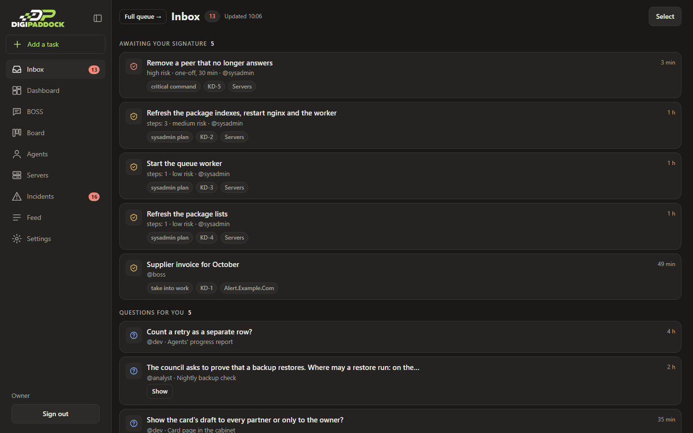

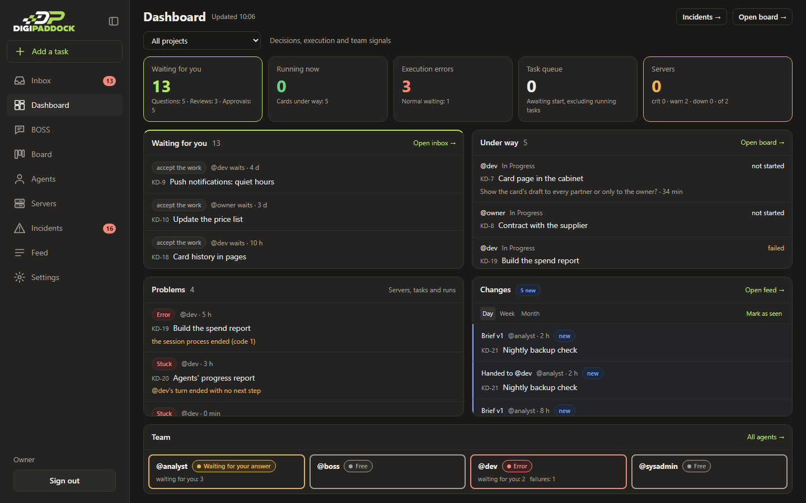

Partners and viewers see only the projects named for them. Details: [cabinet: people and roles](cabinet.md#people-roles-and-sign-in).

## From a card to a release

The developer works test-first in a worktree per card and opens a pull request from an account that cannot write
to the target branch; a project's locked dependencies it installs itself (`kd-deps install`: the lock file only, no
install scripts). After a merge the server steps of the rollout go to the sysadmin as a plan of its own. Where the card's council names critics for the code and the pull request is large enough
(100 changed lines of code by default), they read the published head first: the developer answers what they find —
or the rounds run out — and only then is the owner asked
([the council of models](cabinet.md#a-pull-request-under-its-council)). The required checks run on the factory, not in the
developer's sandbox: a fresh checkout per head, no network, no secrets, statuses written on the head. The owner signs
the pull request in the cabinet (or approves in Forgejo); the code host merges only an approved head. A release
switches to a new tree atomically, checks the platform's health and reports it in the card; a rollback is one
command.

Details: [architecture: delivering code](architecture.md#delivering-code).

## Servers and incidents

A monitor without a model checks every server on a schedule — disk, memory, updates, reboots, ports, logins, units,
cron, VPN peers — against a baseline and trusted lists. A known routine event is remembered quietly; the unknown
opens an incident. One tick's change on many servers is one group, acknowledged or muted together. The baseline
changes only by the owner's passkey signature; a login whose key was already taken away closes as “access removed” —
checked against the server's latest key snapshot, never trusted. The sysadmin
investigates through a read-only gateway (allowlisted commands, no shell; SQLite files read with a memory ceiling)
and proposes a plan; a critical incident can also be duplicated to Telegram.

A plan is made of typed steps where it can be: a system upgrade, one line of root's crontab, one sysctl or logrotate
file, a project's own tool or switch, a reboot that first records the routing, VPN, listeners and services. The
server's gate runs a typed step as its own words, without a shell, and keeps the state before the card's first
change; a server can be told to refuse every script while typed steps go on.

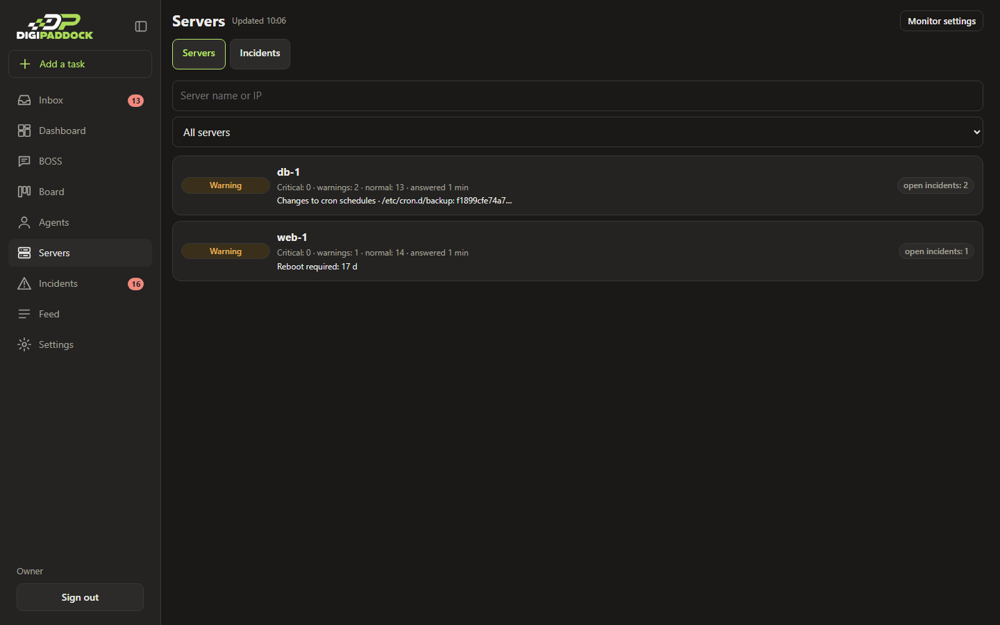

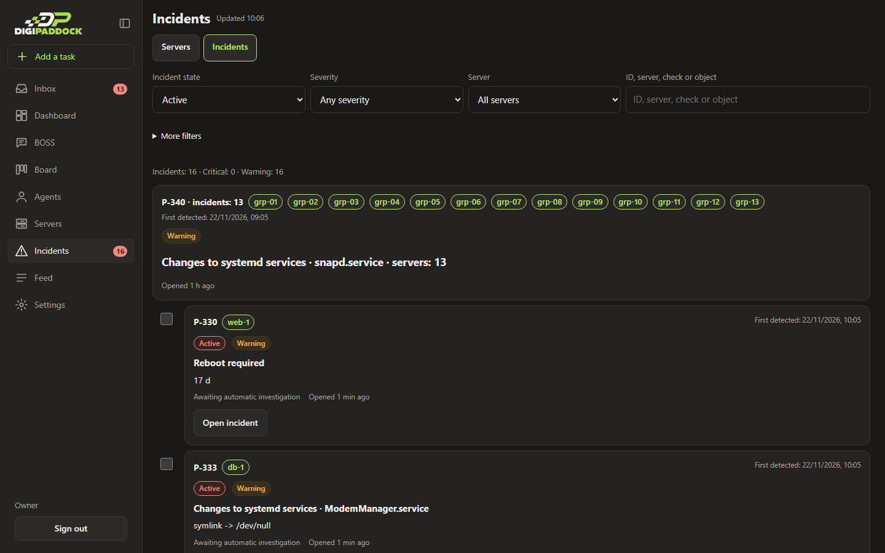

Details: [cabinet: servers and incidents](cabinet.md#servers-and-incidents), [architecture: operating servers](architecture.md#operating-servers).

## On the phone

The cabinet is a PWA: the side menu becomes a tab bar and every screen fits 360 px. Push notifications arrive by rules
per kind and level, with quiet hours and a morning digest. A voice message in a thread or a chat is transcribed on
the host, without network, and the agent reads the text.

  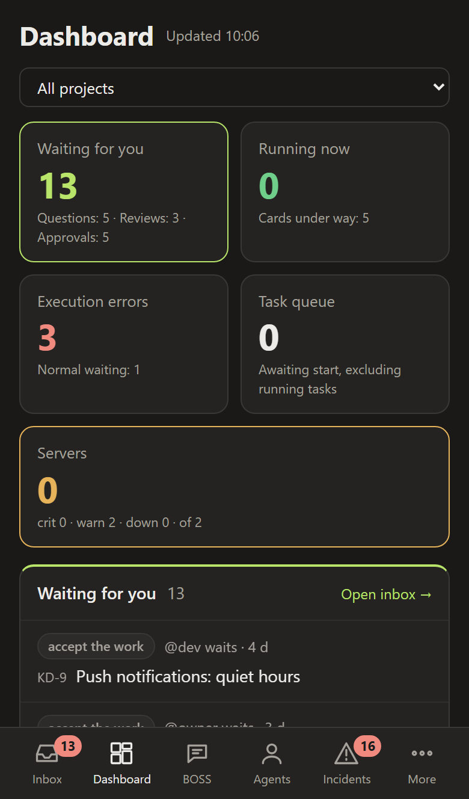
  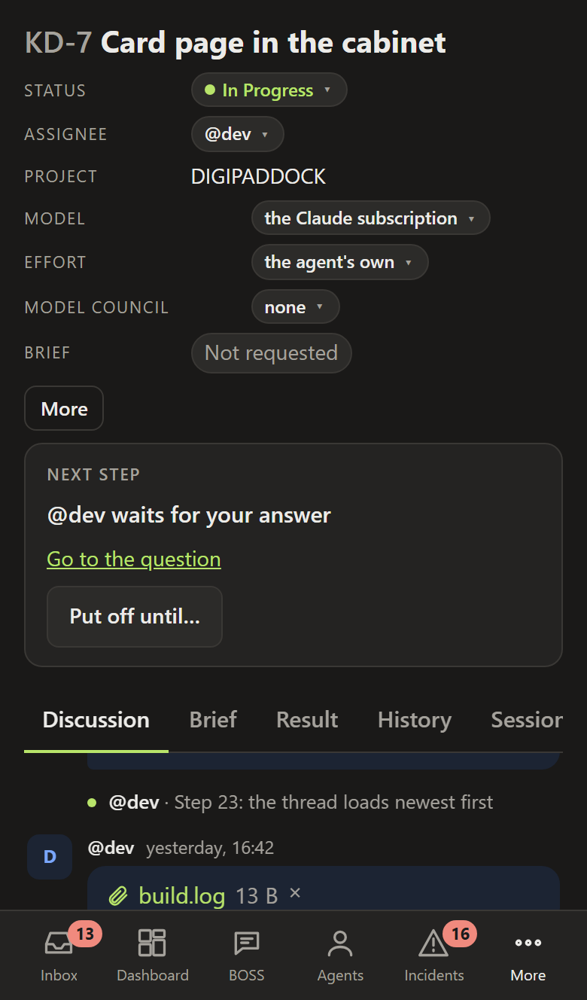

Details: [cabinet: notifications, voice](cabinet.md#notifications).

## Limits that do not depend on the model

Instructions explain the policy; they do not enforce it. Every power an agent has is a capability with a checked
executor, and everything it must not do is unreachable for its Linux user:

- a separate Linux user per agent and an OS sandbox (bubblewrap) for every shell command;
- capability channels instead of sudo: a privileged call goes through a Unix socket to a service that checks the
  caller and a permission file;
- executors that validate every argument under their own service users;
- approvals as signed decisions recorded where agents cannot write;
- card text, pull requests, logs, command output and memory are data, never commands;
- the sandbox reaches only its allowed hosts; more opens only through the deployment's VPN exits — for one card
  with the owner's consent, or standing for the agents the deployment names — and a card may choose an exit's
  country by a label ([exits](probe-egress.md));
- kill switches: one root action stops a power, an agent or everything at once.

Details: [security model](security-model.md).

## Memory

Agents keep a notes file across sessions and, with the optional memory service ([Hindsight](https://github.com/vectorize-io/hindsight)),
a memory bank each: they search it before answering about history and store finished cards, the owner's decisions
and pitfalls. A project can have its own bank shared by whoever works on its cards. A host without the service runs
on 2 GB of memory.

Details: [installing: with or without the memory service](install.md#with-or-without-the-memory-service).

## A new agent without new code

An agent type is an `agent.json` that selects a profile and capabilities from a finite registry, plus instructions. A
compiler turns it into the complete policy — Claude Code permissions, hooks, sandbox, launch settings, channel
permissions, install steps — and refuses an unknown field or an incompatible combination before anything changes on
the host. Kinds of work are versioned specializations of an existing type, chosen per card by a label.

Details: [architecture: agent from settings](architecture.md#agent-from-settings), [new agent checklist](agents/new-agent-checklist.md).

## Install, release, roll back

- One script, `bootstrap.sh`, takes an Ubuntu 24.04 host to a running factory, phase by phase; every step checks first,
  so it can run again at any time, and stops where a step is the owner's (a key, a token, a login).
- An optional `bootstrap.sh starter` puts a minimal start on the board: a few cards of the owner's — a tour of the
  cabinet, the first task, the first server, a partner.
- The public code holds no deployment's values: host names, addresses and inventory live in the deployment's private
  overlay repository, and two privacy scanners gate every release and every push to the public mirror; the mirror
  gets snapshots of `main`, never the private forge's history.
- A release is `main` of the code and the overlay, composed, checked and switched atomically; signed tags, a health
  check after every release, `--rollback` to the previous tree.

Details: [installing a host](install.md), [deployment overlay](deployment-overlay.md).

## Cheap when idle

A tick with nothing to do costs no model call: stall detection, monitoring and alerts run without an LLM. Agents'
instructions are in English to save tokens; text for the owner is in the owner's language (English or Russian in the
cabinet). Tokens and the cache hit rate are counted per agent and per worker job.

A card or a project can be put on another model of the subscription, or on a model of another provider (the Anthropic API, the OpenAI API through a local
transport, OpenRouter, Fireworks, DeepSeek or a custom Anthropic-compatible endpoint) and on an effort level, from the cabinet; the provider's key stays in a root file on
the host, usage is priced by the model's own table, and a model that cannot run fails the card's command with the
reason instead of falling back to the subscription ([cabinet](cabinet.md#models-and-providers)).

## Try it

The cabinet runs on a developer's machine with no installation, over a local state directory and a synthetic seed —
the one in these pictures. See [local development](../README.md#local-development-and-tests).
