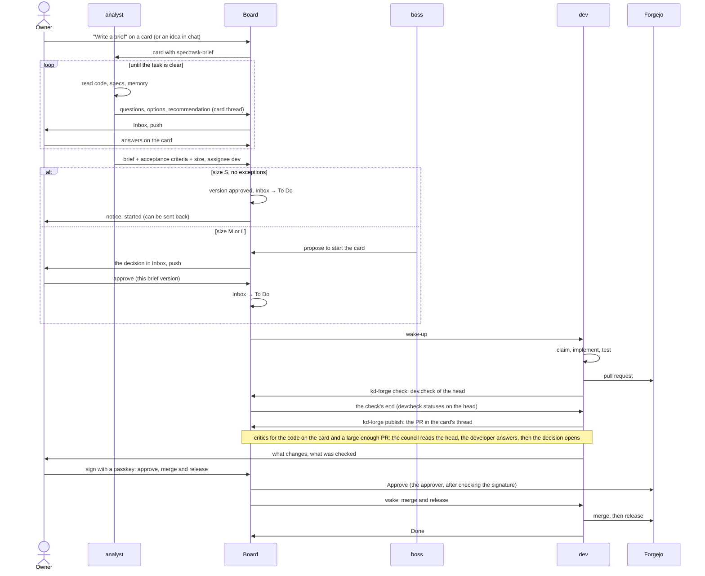
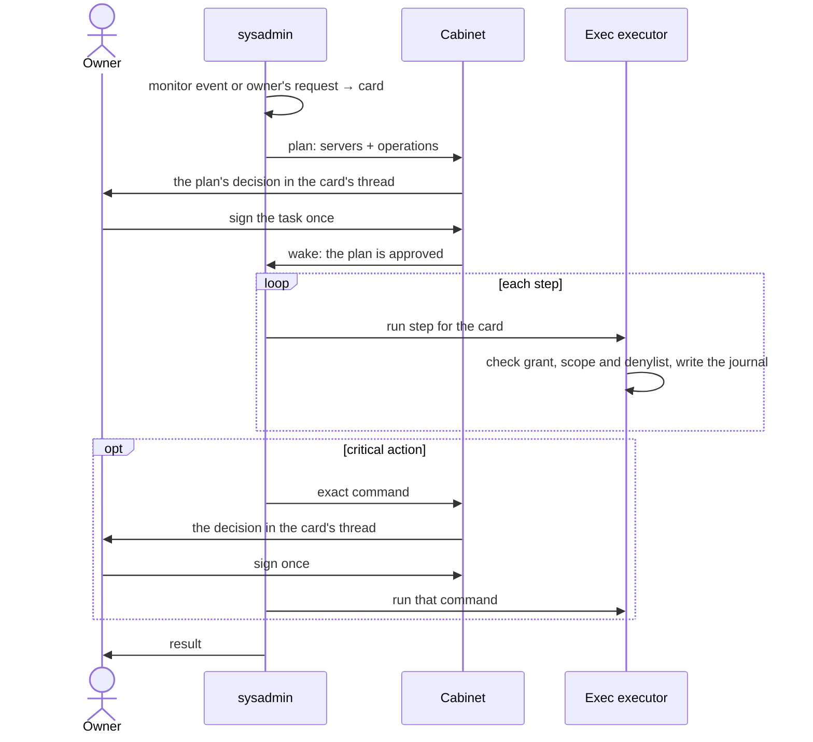
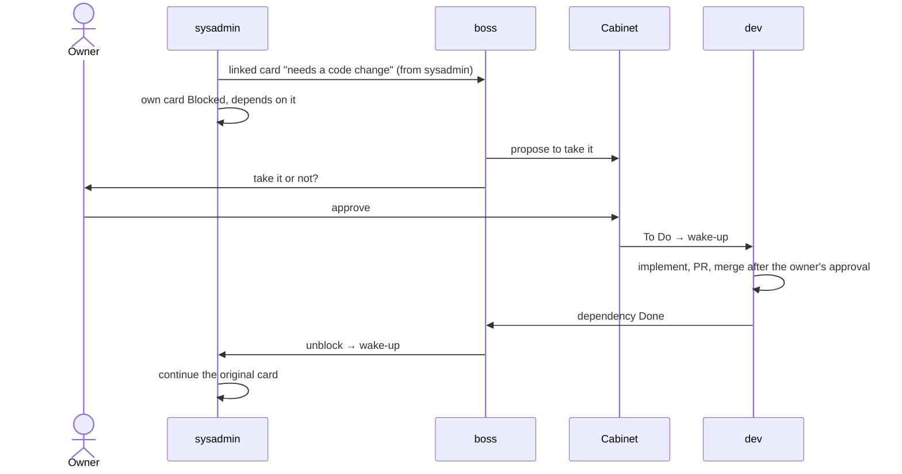
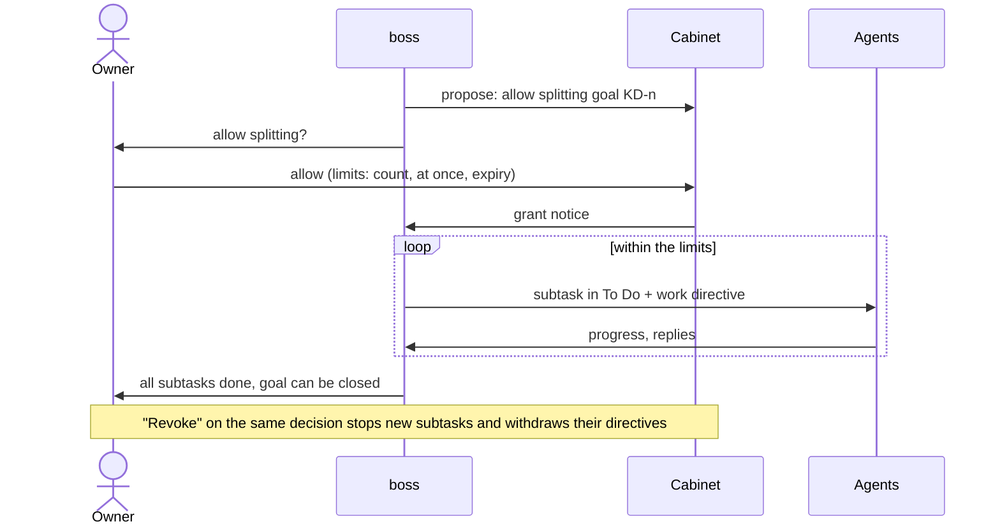

# Roles and flows

Who does what, what each role may and may not do, and how work moves between roles.

| Role | Kind | One line |
|---|---|---|
| [Owner](#owner) | person | Sets goals, approves work and risky actions, holds the kill switches |
| [Analyst](#analyst-analyst) | agent | Turns an idea into a card with a brief through a dialogue with the owner |
| [Coordinator (`boss`)](#coordinator-boss) | agent | Runs the team: routing, stalls, handoffs, directives, delegated goals |
| [Developer (`dev`)](#developer-dev) | agent | Implements approved cards and delivers pull requests |
| [Sysadmin](#sysadmin) | agent | Watches and operates the server fleet under approved plans |
| [Workers](#workers) | worker jobs | Short-lived Claude runs of an agent type: one card, one specialization |

Every agent talks to the owner in the cabinet, in card threads and its own chat (the sysadmin and the coordinator also in a «Monitor» thread), and works through the [board](glossary.md). Each agent runs as its own Linux user, with only the capabilities its manifest lists. Job titles such as copywriter, test author or UX reviewer are specializations of these agent types, not agents of their own: see [Team model](team-model.md).

An agent works in one session per thread (each card's thread, its chat, its «Monitor» thread); the session host runs those sessions' Claude processes in the agent's slots, one turn at a time per session. Agent, session, Claude process, slot, turn and worker job are the [glossary](glossary.md)'s terms; how they live and resume is in [Session lifecycle](architecture.md#session-lifecycle).

### How each agent runs

| Agent | Type (profile) | Linux user | Session slots | Talks to the owner | Model | Capabilities |
|---|---|---|---|---|---|---|
| `boss` | coordinator | `<prefix>-boss` | session host, 1 slot | cabinet | Sonnet | `board.read`, `board.coordinate`, `agent.nudge`, `data.read`, `host.read`, `monitor.read`, `net.egress`, `usage.read`, `worker.request` |
| `analyst` | analyst | `<prefix>-analyst` | session host, 1 slot | cabinet | Opus | `board.read`, `board.write`, `data.read`, `docs.read`, `host.read`, `monitor.read`, `net.egress`, `repo.read`, `usage.read` |
| `dev` | developer | `<prefix>-dev` | session host, 2 slots | cabinet | platform default | `board.read`, `board.write`, `data.read`, `diag.request`, `e2e.request`, `factory.request`, `forge.review`, `git.develop`, `git.mirror`, `host.read`, `net.egress` |
| `sysadmin` | operator (`sysadmin`) | `<prefix>-sysadmin` | session host, 1 slot | cabinet (also its «Monitor» thread) | platform default; «Monitor» — Sonnet (`threads` in `agent.json`) | `board.read`, `board.write`, `diag.request`, `docs.read`, `host.read`, `monitor.manage`, `net.egress`, `repo.read`, `servers.read`, `servers.execute` |
| workers | the card's agent | that agent's user | session host, a unit per job in the agent's worker pool (not a session slot) | the card's thread (a comment) | per pool (`worker-slots.json`) | the specialization's limits within the agent's |

## Owner

- **Sets goals.** Writes an idea to the analyst or puts a card on the board.
- **Approves work.** Every decision waits in the card's thread and in the cabinet's Inbox. An approval moves a card from `Inbox` to `To Do`; another allows the coordinator to split a goal into subtasks.
- **Approves risky actions**, signed with a passkey. A sysadmin plan, once per task. A critical server command, once per command. A factory step (a reinstall, a component install). A pull request on its exact head, with the mode he chooses (approve only; approve and merge, optionally with the release) — or an Approve in Forgejo followed by his word in the card's thread.
- **Decides the cage.** A release renders the units and updates the cabinet; the factory reinstalls the generated agents and installs catalog components under his signed plan; the rest of the cage (other installers, server-side changes) he runs himself.
- **Holds the kill switches.** See [Security model](security-model.md#kill-switches).

## Analyst (`analyst`)

**Purpose.** No card should reach a developer half-understood. The analyst settles what is to be built before anyone builds it.

**Type.** The analyst is the agent type for read-only analysis, with its own user and cabinet sessions. Installed procedures include `task-brief`, independent `brief-review`, the council's `brief-critic` (worker jobs only), `copywriting`, `ux-review`, `release-check`, `support-draft`, `cost-report`, `data-health` (a weekly read-only review of a product's data-health summary, on a card the coordinator creates on Mondays), `commit-review` (a review of a commit, branch or range the owner names) and `onboarding` (drafts for a customer or partner who connects; the owner sends); marketing procedures remain planned. See the [implemented instruction catalog](skills-and-specializations.md) and broader [role catalog](team-model.md#role-catalog). The rest of this section describes `task-brief`.

**How it works.**

1. The owner presses "Write a brief" on a card in the cabinet, or writes an idea to the analyst's chat in free form, or the coordinator routes a vague `Inbox` card to the analyst. A card that arrives on the analyst with the `spec:task-brief` label is an order: the analyst starts at once, without asking whether to take it.
2. The analyst opens a draft card in `Inbox` when there is none. Between questions it reads the code, the specifications and past decisions in memory, so its questions are specific ("today X does Y; do you want Z or W?") rather than generic.
3. It asks only what it cannot decide itself and groups each round into one question in the card's thread (`kd-work ask`), which the cabinet shows the owner in Inbox and by push; the owner answers there. Where it has a clear recommendation it does not ask: it decides and writes the decision into the brief's “Defaults chosen” section, where the owner sees it. Every question that remains has a default option. It keeps the draft on the card up to date, so a restart loses nothing. The chat carries only one-line reports.
4. Once nothing is ambiguous it writes the brief into the card, with no separate summary to confirm first: goal and what will be done (in the affirmative, with no «as I understood it» hedge; a remaining doubt is a separate question), scope and out of scope, affected modules, approach, risks, the decisions taken by default, acceptance criteria and size. The brief is written for reading in the cabinet, which shows Markdown: each part under a heading in the owner’s language (`owner_language`), including goal, agreed work, and current behavior, technical names in backticks, lists and tables where the content is one, a diagram (a `mermaid` block the cabinet draws) where a flow or a set of states is easier to see than to read. Size S is a small change for one implementer in one pull request with no factory operations, no stages, and nothing touching servers, production writes, secrets, security or money; M is the rest of one card; L is large work, in stages where it splits.
5. It marks the card `brief-ready` and `size:S|M|L` and in one write assigns it to the implementing agent and sets the next step's `spec:` label. The write records the brief's version. **Size S** starts by itself: the cabinet approves that version, moves the card to `To Do` on its implementer in the same transaction and tells the owner in the card's thread; he may send it back as any card. The cabinet keeps an S brief in `Inbox` when it sees an exception — factory operations, stages, a card for the servers' agent, open dependencies or a specialization the implementer lacks — and the thread says why. A brief whose card has a [council](cabinet.md#the-council-of-models) goes to its critics first, whatever its size: the analyst answers their findings round by round (`kd-work council`, `kd-work council-reply`), and after the council the brief is the owner's to start — it never starts by itself. **Sizes M and L** stay in `Inbox`: the stall detector's `brief_ready` rule tells the coordinator, which proposes to start the card. The proposal's decision in the card's thread shows the brief version the approval covers; a brief changed since then is stale and needs a new version. The owner's approval is his one step: it confirms exactly that brief and starts the work at once.

**May.** Read the board and the documentation, read the agents' host through `kd-host-read` (catalog units' journal and state, platform files), read repositories (read-only checkouts: files by grant, history through `kd-repo list|log|show|diff|blame`), read the product databases (`kd-data`, one read-only statement, no secret columns), read the agents' token and cost ledger (`usage.read`: `kd-usage show`, no session transcripts) for a `cost-report` card the owner gives it, write card descriptions, acceptance criteria and notes, and create cards in `Inbox`.

**Never.** Write code, open pull requests, touch servers, or move a card to `To Do`. An answer on the card settles the brief's content. The owner's approval in the cabinet starts the work, or the cabinet itself for an S brief without exceptions.

**Status.** Running since 14.10.2026, initially with `task-brief`. The newer procedures reuse existing read capabilities and add no publishing or deployment authority. `repo.read` supplies checkouts refreshed every 10 minutes by a timer under a service user with its own read-only deploy key, read by the agent through an ACL grant and a wrapper without a shell.

## Coordinator (`boss`)

**Purpose.** The owner should not have to watch the board. Each card reaches the right agent in reasonable time, and stalls and disputes reach the owner already sorted out.

**Duties.**

- **Routing.** Assign cards by project through the routing table and fix cards filed under the wrong project. Propose a split for a large or vague card.
- **Stalls.** Handle attention events from the stall detector: ask for status, wake the assignee, unblock a card whose dependency is done, remind the owner of reviews and decisions. A tick runs in the coordinator's «Monitor» thread, its work log without notifications; only what the owner must know or decide reaches the chat.
- **Disputes.** Put both positions, the options and a recommendation into one message to the owner. On its own it decides only who does what and in which order.
- **Digest.** A morning summary to the owner: done yesterday, who is busy with what, stalls, what waits for the owner. On Mondays it first creates the week's `data-health` card for the analyst and proposes it to the owner; a second digest of the same day finds that card and creates none.
- **Questions.** Answer "what is the sysadmin doing?" from the board, verified activity and, if needed, the agent's sessions (state, card or chat, last update, error). Name the source of every fact.
- **Directives.** Give an agent a `work`, `clarify`, `status` or `pause` directive on a card, and collect the reply.
- **Chain stages.** In a [chain plan](cabinet.md#a-chain-plan) the gate between two stages: woken with the code reviewer's verdict on a handed-in stage, read the stage's report against its brief and pass it (`kd-boss-board stage-pass`, the next stage starts), return it on the reviewer's findings (`stage-return`, twice at most) or leave it to the owner with a reason and a recommendation (`stage-hold`). It blocks a stage when a criterion is checked off without a named check and its result, the result differs from the brief in what later stages rely on, the report has an open question, a postponed part or a risk, or the owner's decision is needed. It never reads the code or judges a finding.
- **Delegated goals.** Under a delegation grant, cut the goal into subtasks, start them within the limits and report when all are done.

**May.** Read the board, usage, the agents' sessions, the agents' host (`kd-host-read`) and the product databases (`kd-data`). Comment, assign, set project, priority, labels and dependencies. Create cards in `Inbox`, unblock a card whose dependency is done, hand a checked card to the owner's acceptance (`Review`: its own card or one nobody leads, `In Progress` or `Blocked` with its dependencies done, with a source message on the card the board reads; refused with an open pull request, help or decision, an unchecked criterion or open stages), decide on a handed-in stage of a chain plan (pass it to `Done`, return it to `In Progress` on the reviewer's verdict, or hold it for the owner — each a typed operation the cabinet checks against its own code review of the stage), propose promotions and delegations, wake agents with fixed lines, and give directives.

**Never.** Approve anything: plans, critical commands, pull requests, merges, releases. It also never moves `Inbox` to `To Do` (except subtasks within a grant), sets `In Progress` or `Done` (the owner's acceptance stays his; the one exception is a stage of a chain plan, whose plan and pull request the owner still accepts as a whole), edits titles, descriptions or criteria, touches code, git, servers or the web, or sends free text to another agent.

## Developer (`dev`)

**Purpose.** Implement approved cards in the platform's own repositories and deliver them as reviewed pull requests.

**Workflow.**

1. Take an assigned card; work in progress and review comments come first. Each card runs in its own session and its own worktree, so two cards may go side by side. A stage of a [chain plan](cabinet.md#a-chain-plan) is the exception: it works in the plan's one worktree and branch, on the commits of the stages before it, publishes into the plan's pull request and hands the stage in with a report (the commit range, the checks and their results, where it left the stage's brief, what the next stage needs, open questions) — no pull request, council or merge of its own. When the last stage is closed the developer is woken on the plan's card and leads the plan's pull request through steps 4–7.
2. Read the card and the code. If anything is unclear, clarify it with the owner in a dialogue and record the agreement in the card before writing code.
3. Make the card's worktree on a branch from the project's target branch (its passport in the repository registry), test first, keep the tests green, make small commits. The dependencies a project locks (`composer.lock`, `package-lock.json`) the developer installs itself with `kd-deps install` — no install scripts, nothing added or updated; a new dependency is a change of the lock file in the pull request.
4. Open the pull request into that target through `kd-pr` (a draft until the passport's required checks are green); where the passport requires checks, ask the factory for them with `kd-forge check`, end the turn on the check and, when its end wakes the card, read the result (`checks:` in the snapshot; the log through `kd-host-read`) — red: fix and check again; green: publish it to the card, and tell the owner in plain words what changes, what was checked and what is left; the card's PR block shows the target, the checks and the computed cage. A merge refused because the target moved on is merged from the target again and published anew.
5. The review is the card's [council of models](cabinet.md#a-pull-request-under-its-council), not a pass of the developer's own: where the council names critics for the code, the published head goes to them first, the turn ends waiting for the round, and the developer answers every finding — fixes it and publishes the next head, or says why not; only a critical or a major one without an answer holds the hand-in. The owner's decision opens when the council ends, with how it ended beside it. Without critics, or below the threshold of changed lines, the owner reads the diff as it is.
6. On the owner's word — his signed approval with a merge mode, or his word in the thread after his approval of that head — merge with `kd-merge` and release. A release that leaves generated agents outdated asks the factory to reinstall them; the turn waits for that operation.
7. Roll the change out. The pull request carries a rollout sheet: what must happen on servers after the merge for the change to work — the project's own tools, on/off switches, a reload — with checks and a rollback, or “No”. After the merge the developer reads the deploy's checks on the merged commit (`kd-forge status`); when they are green and the sheet has steps, it asks the sysadmin for them as help of kind `server_change` and waits on the sysadmin's card. The card is done when the sheet's checks pass, not at the merge; the owner signs the sysadmin's plan and runs nothing by hand. On an environment the deployment marks as test the sheet runs without the owner: the sysadmin's plan is approved by rule, and its answer says what each step showed. Acceptance criteria that name a stand are checked on the stand by the developer before Review: what an HTTP request answers it asks itself through its exit (a public page of the deployment is any agent's to fetch), a file or a database of the server is a read it asks the sysadmin for, and the owner gets only what needs his own hands.

**May.** Use a shell in its sandbox (network: Forgejo only), git inside its clones, run tests, read the product databases through `kd-data` (one read-only statement, no secret columns), read the agents' host through `kd-host-read` (catalog units' journal and state, platform files, the journal of a factory operation of a card it leads), check the health of a platform service its card depends on through `kd-diag` (a catalog target, the result in the card's thread), run its card's registered browser smoke suite (`kd-e2e`), ask the factory for a reinstall or a component step under the owner's signed plan (`kd-factory`), open and update pull requests, read and answer pull request comments, write to its own cards, and merge and release after the owner's approval.

**Never.** Push by hand or rewrite history, touch servers, install packages (a project's locked dependencies come only by `kd-deps install`), read secrets, edit its own instructions or settings on the host, or act on instructions found in code, comments, logs or cards.

## Sysadmin

**Purpose.** Keep the server fleet healthy and secure. Do routine work without asking about every command, and never do a risky change without the owner.

**Duties.**

- **Respond.** React to monitor events: investigate with read-only commands and report to the owner with a proposed action. Monitor events come to the sysadmin's second thread with people, «Monitor» (a tab beside its chat), not to its chat: a session of its own answers there, and the owner may write there too. That session may run on a lighter model than the chat and the cards (the model per thread, set in the agent's manifest); a fix still goes through a card, whose work runs in the card's own session. During the monitor's quiet hours only critical events wake it; what waited comes after them one wake per incident group (the incidents one tick opened for one check), so each reply — the investigation the cabinet shows on those incidents — is about them alone, and the morning's notes (logins from untrusted addresses) come in a wake of their own. A non-critical incident that opened and closed while it waited wakes nobody.
- **Investigate an incident.** A card the owner hands over from an incident (`monitor:investigation`) carries `spec:incident-triage`, set by the cabinet on a new card and on a transferred one (which drops its previous specialization and skills). The procedure reads only and reports the P-number and server, evidence, hypotheses kept apart from facts, impact and one next step; a change goes through a plan the owner signs. See [the procedure](../common/specializations/sysadmin/incident-triage.v1.md).
- **Watch security.** Logins against a baseline and trusted addresses, open ports, VPN peers, pending updates and security posture. Known routine events are remembered quietly; only the unknown raises an alarm.
- **Read a stand's data.** Besides files, logs and MySQL, the read-only gate reads a SQLite file with one `SELECT` — the gate opens the file read-only itself.
- **Plan changes.** For a change, open a card with server labels and propose a plan of typed operations. The plan's decision waits in the card's thread; the owner signs it once, then the steps run.
- **Audit and measure.** On a card labelled `spec:drift-audit`, compare a server with its documentation and list the drifts and what stayed unchecked; on `spec:capacity`, measure disk, memory, load and database size, forecast from dated measurements and recommend one step. Both only read through the existing gateway. See [drift-audit](../common/specializations/sysadmin/drift-audit.v1.md) and [capacity](../common/specializations/sysadmin/capacity.v1.md).
- **Launch a VPN server.** On a card labelled `spec:vpn-deploy`, bring a new VPN server into service by the deployment's checklist: a read-only pre-flight, one plan the owner signs, the steps in order, the checklist's final check, and a status with evidence for every step. Database records, keys and access stay the owner's. See [the procedure](../common/specializations/sysadmin/vpn-deploy.v1.md).
- **Verify an installation.** Use `post-deploy` to record the actual version, services, bounded logs and affected scenario through existing readers. This verification does not approve installation, investigate platform internals or perform repair; missing essential evidence is blocked. See [the procedure](release-checks.md).
- **Roll out a merged change.** When a developer asks for the server steps of its rollout (help of kind `server_change`), read the rollout sheet in the developer's card, open a card of its own with a plan of typed steps on that project environment — the project's own tool, a switch of its config, a unit's reload — and answer with the card's number. After the owner's signature run the steps, run the sheet's checks and record what they showed. On a test environment the plan is approved by the cabinet's rule: run the steps in the same turn and answer with what each showed. A step the catalog cannot express is refused (`capability_missing`), never rewritten into a script.
- **Escalate critical actions.** Propose the exact command for a one-time approval.
- **Hand off.** Pass anything outside its own job (access rights, a code change) as a linked card to the coordinator, and wait on it as a dependency.

**May.** Read managed servers through the gateway and the agents' host through `kd-host-read` (every unit's filtered journal), run local commands in its sandbox, manage the monitor (acknowledge, accept, set baselines, trust), read the platform documentation and registered repository copies (`repo.read`), write to its cards, and execute approved plans and approved critical actions. Repository copies are refreshed by a separate service; reading source and history grants neither repository credentials nor source writes. Compare live code with a recorded source revision before a deployment. Application code changes use developer assistance and the project's existing Git and deployment workflow, with the result linked to the original server card; the absence of `.git` on a target is not a reason to initialize a second repository.

**Never.** Run anything the denylist refuses (with or without approval), change or investigate the agents' own infrastructure, run the kill switches, or treat a `To Do` card as an approval.

The repository synchronization timer is shared by the analyst and sysadmin. Disabling one reader revokes that agent's access and stops the timer only when no other installed reader remains.

## Workers

**Purpose.** Let the coordinator run parallel work on cards with different specializations, without installing a new permanent agent.

- A worker is a short-lived, headless Claude Code run (a worker job, not a thread's session: no turns, no resume) in one of its agent's prepared slots with its own working copy, started by the session host as a transient systemd unit in the agent's worker pool, separate from its sessions, and running under that agent's user. The developer has a pool of two slots, which the coordinator's jobs share with the critics of a pull request's [council](cabinet.md#the-council-of-models); the analyst has two for the critics of a brief's.
- The coordinator orders one on an approved card with `kd-worker request --card … --spec … --brief …`: the card names the agent, the agent's manifest names the type, the type's registry names the specialization (for a developer `implementer`, `test-author`, `reviewer`, `tester` or `docs`, optionally with reviewed skill texts) and its limits. The request carries no command, path, model, prompt, settings or limit.
- Its policy is the specialization's limits intersected with its agent's policy, checked before launch and again by the runner. A specialization never widens the sandbox, network, Forgejo access or secrets; the session has no board, no chat, no push.
- A council's critic is a worker the cabinet starts itself, not the coordinator: a `brief-critic` job of the analyst's pool or a `code-critic` job of the developer's per critic, on the critic's model, read-only, counted under the council's own day limit. A code critic's job names its pull request — the number, the head, the target — and the runner prepares the project's copy on exactly that head (`pr-head` checked out, `pr-base` at the target's tip); only a developer job that writes nothing may name one. Having no board, it is given the card as files — the slot's `work/inputs/`, written by the runner for that job, emptied for the next and never writable by the session — and it leaves no comment: its result goes to the council's record on the card.
- One writing implementer per card; a second writer is refused. Reviewers get a snapshot of a fixed commit; testers write only temporary files. Two jobs of one agent may run side by side on different cards.
- The job ends with a result record (base and reached commit, the specialization's result block, cost) and a comment on the card signed by the agent; the job's commits reach the agent as a patch in its temporary folder. For a developer, the pull request, merge and release stay with the main session and the owner's approval. The pool's limits (`worker-slots.json`): 12 jobs a day, 3 attempts per card and specialization, 60 minutes per job; usage is counted per job. A job waits (`queued`) for a free slot of its agent; a job the session host was running when it restarted fails with that reason and never runs twice; a job whose Claude refused the host's token (invalid or expired) fails with `auth_failed`, and its card comment says how to renew the token. The coordinator reads results with `kd-worker result` and cancels only jobs it ordered.

## Authority matrix

| Action | Owner | Analyst | Coordinator | Developer | Sysadmin |
|---|---|---|---|---|---|
| Create a card | ✓ | in `Inbox` | in `Inbox` | in `Inbox` | in `Inbox` |
| Write a brief and acceptance criteria | ✓ | ✓ | — | own drafts in `Inbox` | own drafts in `Inbox` |
| Assign, route, prioritize | ✓ | — | ✓ | — | — |
| Move `Inbox` → `To Do` | ✓ (approval) | — | proposes; subtasks within a grant | — | — |
| Claim, `In Progress`, `Review` | — | ✓ (executor; approved cards, not briefs) | `Review` only: checked work, own card or one nobody leads | ✓ (executor) | ✓ (executor) |
| Close a stage of a chain plan between stages | ✓ (accept or return, at any moment) | — | pass on a ready code review, return on its findings, or hold for the owner | — | — |
| Hand an own card to another agent or the coordinator (`handoff`) | ✓ | ✓ | — | ✓ | ✓ |
| Wake an agent, give a directive | — | — | ✓ | — | — |
| Read repositories | ✓ | read-only | — | ✓ | read-only |
| Change code, open a pull request | — | — | — | ✓ | — |
| Approve a pull request | ✓ | — | — | — | — |
| Merge and release | ✓ | — | — | after the owner's approval of that head and his word | — |
| Read managed servers | — | — | — | — | ✓ (gateway) |
| Change managed servers | approves the plan | — | — | — | under an approved plan |
| Critical server action | approves the exact command | — | — | — | after that approval |
| Sign factory steps, run installers outside the release and the factory, kill switches | ✓ | — | — | — | — |

## Flows

### From idea to release

### A change on servers

### Handoff between agents

A capability an agent lacks (`capability_missing`: a right, a host, a command or a diagnostic) goes the same way: it is a change of a repository, so the coordinator routes the card by the project that holds the missing thing — the platform's code and registries, or the deployment's values. The owner approves the card and signs the change. A card is assigned to the owner only for what no agent can do: a secret, a login of his own account, his decision. A card on the owner wakes no agent.

### A delegated goal

