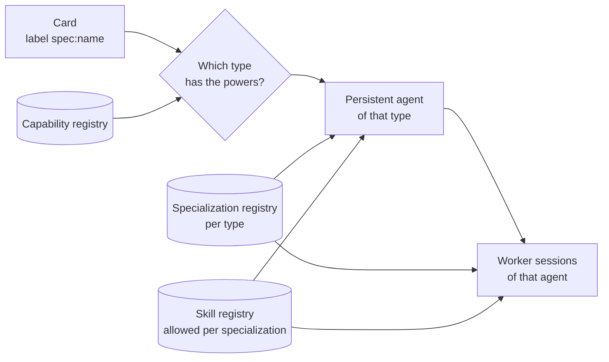
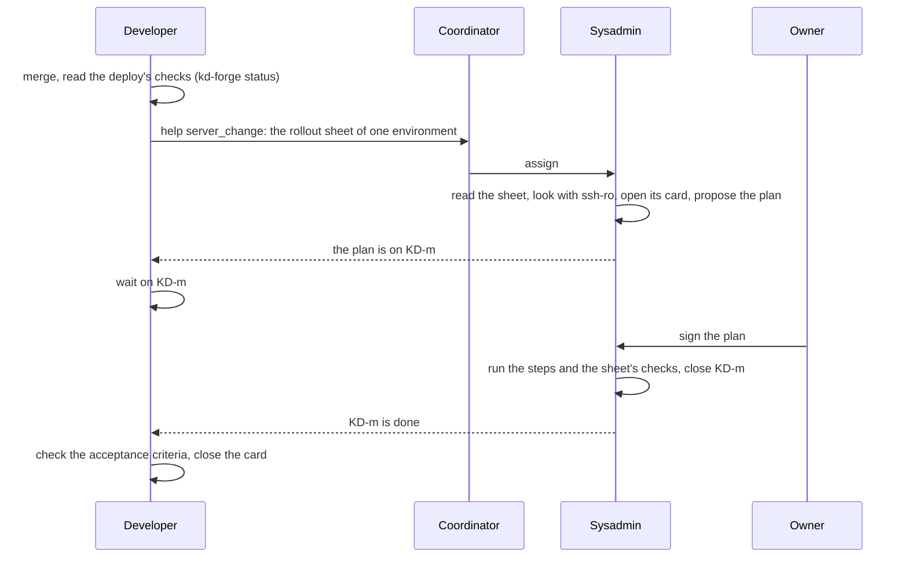
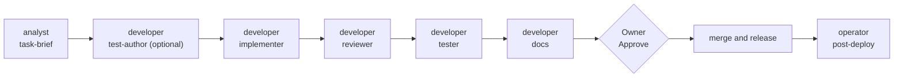

# Team model: agents, types, specializations and skills

A new kind of work rarely needs a new agent. An agent is the executor, a specialization is its work procedure and result contract, and a skill is reusable professional knowledge. DigiPaddock separates five things that are easy to conflate when people say "role":

| Question | Mechanism | Cost of a new one |
|---|---|---|
| What may it do? | **Agent type**: a profile of powers, the capabilities its agents may hold | A capability module, written once, if no existing capability gives that power |
| Who is it, and who does it talk to? | **Persistent agent** of a type: its own Linux user, sessions and chat in the cabinet | An install |
| How does it do the work? | **Specialization**: a versioned instruction text with hard limits | One file, reviewed in a pull request |
| Which subject knowledge does it use? | **Skill**: reusable instructions selected for a specialization | One file and compatibility entries, reviewed in a pull request |
| How much runs at once? | **Session slots** of the agent (one per running thread) and **worker jobs** of the same agent in its worker slots, under its user | Nothing: slots are shared |

A copywriter, a test author or a UX reviewer is a specialization, not an agent. Today each installed type has one persistent agent; a second agent of the same type (a separate cabinet chat, other repositories) would get its own Linux user. A persistent identity can have many sessions: one session per thread (each card's thread, its chat), each with its own conversation that the session host starts once and resumes in a new Claude process whenever the old one closed; the agent's session slots bound how many processes run at once, and its worker jobs run in a separate pool. The terms (agent, session, Claude process, slot, turn, worker job) are the [glossary](glossary.md)'s; the lifecycle is in [Session lifecycle](architecture.md#session-lifecycle). Its model is configured separately from the specialization and skills.

Workers and persistent sessions use the same selection validator. Persistent cards use `skill:<name>` labels; worker requests use `--skill <name>`.

## Agent types

| Type | Powers | Channel | Agent today |
|---|---|---|---|
| **Coordinator** | Coordinate the board, wake agents, give directives; approves nothing | cabinet chat | `boss` |
| **Analyst** | Read only: board, repositories, documentation, data sources. Writes only to cards | cabinet chat | `analyst` |
| **Developer** | Code: own clones, tests, pull requests; merge and release after the owner's Approve | cabinet chat | `dev` |
| **Operator** | Servers: read through gateways, change under approved plans | cabinet chat | `sysadmin` |
| **Communicator** | Talks to people other than the owner (customers, an audience) | the outside channel | future |

The owner is not a type. The owner sets goals, approves, spends money and holds the kill switches.

### When a new type is justified

1. **Powers that cannot be added to an existing type without widening it dangerously.** For example, read access and write access to production in one session.
2. **A channel with other people.** An agent that answers customers or replies to an audience on its own is a communicator.

None of these is a reason for a new type:

- a new subject or a new kind of analysis (that is a specialization);
- more load (that is a job for worker sessions);
- a dangerous external effect that the owner approves every time (that is a capability on an existing type: an executor holds the token, the agent only asks).

## Specializations

A specialization is an instruction text bound to one agent type. It states the purpose, the inputs, the procedure, the output format and the limits. It adds knowledge and a way of working, never powers.

- **One text, two runtimes.** The same specialization is loaded as a playbook by the type's persistent agent and as a prompt pack by a worker of that agent. Each runtime adds its own frame: a worker, for instance, runs unattended and ends with a structured result.
- **Hard limits.** Each registry entry also declares what a worker with this specialization may touch: writes (none, temporary files only, or its own working copy), an explicit list of capabilities, and network. The worker's policy is these limits intersected with its agent's policy, checked before launch. A reviewer gets a read-only snapshot of a fixed commit; a tester writes only temporary files; an analysis worker on an unapproved card never gets an effect such as `publish`.
- **Choosing.** A card label `spec:<name>` selects the specialization. The coordinator sets it when routing (`assign --spec`, with the assignee in the same write); the owner can name it in chat. A card without a label gets the type's default. A handoff changes the assignee and the label in one write, so no agent ever sees a half-handed card; a handoff or reassignment without a new label drops a label the receiver does not hold. Before the work the agent's installed copy of the text is checked against the registry byte for byte, so the note's hash always names the text the agent read.
- **Adding.** A new specialization is a file plus a registry entry, reviewed in a pull request. An unknown label is refused, not guessed.
- **Traceability.** Every result records the hash of the exact specialization and skill texts it ran with, not just their version numbers.
- **Skills.** A skill is reusable know-how attached to specializations, not a specialization of its own. `frontend` (Svelte, design tokens, responsive layout, UI checks) is allowed for `implementer`, `ui-design`, `reviewer` and `tester`. Workers and persistent agents load explicitly selected skills (at most two, checked for conflicts, with recorded versions and hashes).
- **Missing inputs.** Each specialization lists the inputs it needs. A persistent agent asks for a missing one on the card before the work; a worker cannot ask, so it ends `blocked` with a list of `missing_inputs` for the card's lead. Only the persistent agent opens a pull request; a worker returns a commit.
- **Planned, not installed.** A specialization the registry does not hold yet (marketing) cannot be assigned: its label is refused until its delivery installs it.

### The analyst's two modes

- **A brief.** A card in Inbox with `spec:task-brief`: the analyst clarifies the task with the owner and writes the brief on the card. No claim: the card stays in Inbox until the owner approves the brief; a brief of size S without exceptions starts by itself (see [roles](roles.md)). A large brief is written as stages. Stages of one role in one repository run as a [chain plan](cabinet.md#a-chain-plan) — one branch, a code review and the coordinator's gate between stages, the owner's one decision at the end — so the analyst orders them as they must run and makes each stage's criteria name what the next one relies on; a stop for a rollout or the owner's decision is a stage of another role or a card of its own.
- **An approved card.** A card in To Do on the analyst with another label (`copywriting`, `ux-review`): the analyst claims it, reads that specialization, asks on the card for a missing input, puts the result on the card and hands it to the owner for review. A card in Inbox with such a label waits for the owner's start.

## Skills and specialization composition

A specialization answers "what work and what result?" A skill answers "which professional rules apply while doing it?" Both are versioned instruction texts in [the same registry](../common/specializations/specializations.json), rather than new model instances or permission grants.

They are reusable parts of the model's prompt. The [implemented catalog and source-file guide](skills-and-specializations.md) lists the Markdown texts, current compatibility and how persistent and worker runtimes compose them. This project uses its checked registry rather than automatic native skill discovery.

For example, `implementer` defines how to read a task, change code, run checks and return a commit, tests and notes. The `frontend` skill adds Svelte conventions, design tokens, responsive widths, accessibility, localization and UI checks. The same frontend knowledge is useful to other procedures:

| Agent and type | Specialization | Selected skill | Result |
|---|---|---|---|
| `@dev`, `developer` | `implementer` | `frontend` | Implementation, commit and checks |
| `@dev`, `developer` | `reviewer` | `frontend` | Verdict and findings |
| `@dev`, `developer` | `tester` | `frontend` | Check results and failures |
| `@dev`, `developer` | `ui-design` | `frontend` | Screens, states, tokens and a prototype |

These are different jobs of the same agent. The selected skill is loaded for a worker job or a persistent card with the matching `skill:<name>` label. `frontend` is a skill because the implementation procedure already exists and its subject knowledge can be shared across procedures.

The copywriting split has a different cause: `copywriting` belongs to `analyst` and produces drafts on the card; `site-copy` belongs to `developer` and changes repository files through a pull request. The subject overlaps, but the actions require different types and result contracts. Specialization names are global registry keys, so these two entries also need distinct names.

Selection and execution follow these rules:

1. Choose an agent whose type and granted capabilities support the task. A specialization's `requires` tests existing capabilities; it does not grant them.
2. Select one specialization with the card's `spec:<name>` label, or its type's available default. Multiple specialization labels and incompatible labels are refused.
3. Select zero to two skills with `skill:<name>` labels for a persistent card, or `--skill <name>` for a worker job. The specialization's `skills` list is an allowlist, not a list loaded automatically. An allowlist of three skills is valid; choosing three for one job is refused. Unknown, incompatible, duplicate or conflicting selections are also refused.
4. Compose the worker's instructions from its runtime frame, specialization text and selected skill texts; pass the card brief separately as task data. Record the exact versions and hashes. The specialization and skills never widen the agent's policy.
5. Persistent cards use `skill:<name>` labels. Claim checks and names each installed text. Before every turn, including resume, the host rechecks the current selection and installed bytes and sends the checked texts; changed provenance is recorded on the card. Read the installed files before effects when the selection changes. A stale or altered copy stops the turn with a reinstall error. An incompatible selection on handoff/reassignment is refused atomically: remove or replace the skills in the same edit.

### Choosing what to add

| Need | Add or change |
|---|---|
| A new procedure, required inputs or result contract | A specialization of an existing type |
| Knowledge reusable by several procedures | A skill, with an explicit compatibility allowlist |
| A refinement already covered by an existing skill | Improve that skill rather than duplicate its rules |
| Another persistent identity, independent configuration or repository scope | An agent of an existing type |
| More simultaneous work | Worker sessions |
| A new data source, tool or external effect | A capability with an executor and checks |
| A permission boundary or external audience that existing types cannot safely cover | A new type, with its own threat model |

Every new specialization or skill needs a representative task that demonstrates a useful result, including missing-input behavior. A registry entry alone is insufficient acceptance evidence. Reusable product facts and design rules must refer to their maintained sources; a skill must not invent them or silently replace the project's documentation.

## Capabilities for new kinds of work

Kinds of work that need data the platform cannot reach yet get a capability, written once and selectable by any type whose profile allows it.

| Capability | Gives | Status |
|---|---|---|
| `repo.read` | Read-only checkouts of registered repositories, refreshed every 10 minutes by a trusted unit under a service user with its own read-only deploy key; the session reads files by grant and history through a wrapper (`log`, `show`, `diff`, `blame`); no network, no key | running (analyst) |
| `host.read` | The agents' host through one reader executor under its own service user: the filtered journal of catalog units, systemd read verbs, catalog files, fixed host state; no group or file of the agent opens anything | running (every type) |
| `e2e.request` | A fixed prepared browser smoke executor with synthetic data and an isolated filesystem/network; no arbitrary URL or general browsing | running (persistent developer); no worker channel |
| `data.read` | One read-only SQL statement on a managed server's product database through `kd-data`, an executor under its own service user with its own key; on the server the gateway's MySQL-only mode and a MySQL user without the secret columns (30 s, 1 MB, 2 connections, masked); every call journaled | running (analyst, developer, coordinator); no worker channel |
| `web.view` | A headless browser and screenshots, own domains only | idea |
| `web.search` | Internet search with sanitized results; high injection risk | idea |
| `analytics.read` | Web analytics reports | idea |
| `publish` | Posting to a channel or site; the executor holds the token, the owner approves the exact text each time | idea |

## Help inside an approved card

One lead per card does the work. Reading is every type's: a lead reads the agents' host itself (`host.read`). When a step is beyond its own reads — a managed server, the monitor's state, code another role holds — the lead asks for that one step instead of handing the card over. The coordinator picks a role of the step's kind; the owner is not asked, because he approved the task and help grants no right. The helper does the step with its own tools and answers once on the lead's card; the lead continues. A helper without the tool says so (`capability_missing`), and the lead decides the next step.

One kind of help is not a read: `server_change`. A developer whose merged change needs steps on a server — the project's own tool, a switch, a reload — does not leave them to the owner. Its pull request carries a rollout sheet; after the merge and a green deploy the developer asks the sysadmin for the sheet's steps on one environment. The sysadmin opens its own card with a plan of typed steps and answers with that card's number; the board moves the developer's wait on to that card in the same write, so the answer wakes nobody and the developer's card waits on it. The owner's part is one signature on that plan — the request itself runs nothing and grants nothing. When the sysadmin's card is done, the developer checks its acceptance criteria and closes its own.

## Worker sessions

Workers let the coordinator run several specializations in parallel without new agents.

The current repository configuration declares two developer slots and two analyst slots; the analyst's run the critics of a brief's council (`brief-critic`) and the developer's also the critics of a pull request's (`code-critic`), which the cabinet starts itself. Registry support for a type or specialization does not imply that its worker slots or capability channels are installed. The other analyst procedures and the sysadmin's use their persistent sessions; unsupported worker requests are refused.

- A worker runs in a prepared slot of its agent, with its own working copy, under that agent's Linux user, as a separate systemd unit.
- Its policy is its specialization's limits intersected with its agent's policy. A specialization narrows, never widens.
- The coordinator asks for a worker by card and specialization. It cannot pass a prompt, settings, paths or a model.
- Results go back to the card. The type's persistent agent integrates them: for a developer, the pull request, merge and release stay with the main developer session and the owner's Approve.

## Role catalog

How familiar job titles map onto the model. A specialization marked *(planned)* is not in the registry yet, and neither are the capabilities only it needs (`web.search`, `web.view`, `analytics.read`, `publish`).

| Job title | Type | Specialization | Extra capability |
|---|---|---|---|
| Business or product analyst | analyst | `task-brief` | `repo.read` |
| Independent brief reviewer | analyst | `brief-review` (separate review card, checked basis and verdict) | `repo.read` |
| Data analyst | analyst | `data-health` (weekly read-only review of a product's data-health summary: its warning and failure slices recomputed from the product's code, causes with evidence; a report on the card) | `data.read` |
| Marketer | analyst | `marketing-research`, `seo-audit`, `campaign-plan`, `metrics-report` *(planned)* | `web.search`, `web.view`, `analytics.read` |
| Copywriter: site and docs copy | developer | `site-copy` (before and after in a repository, both languages kept in step; pull request and Approve) | — |
| Copywriter: posts, newsletters, announcements, sales copy | analyst | `copywriting` (variants on a card, a source for every product claim; the owner publishes) | later `publish` |
| UX researcher | analyst | `ux-review` (findings per scenario step, with evidence and severity) | `repo.read`; later `web.view` |
| UI designer | developer | `ui-design` (screens, states, widths, tokens and a prototype in the repository; no product code) | — |
| Frontend developer | developer | `implementer` with the `frontend` skill | — |
| Developer | developer | `implementer` | — |
| Test author | developer | `test-author` (tests from acceptance criteria, independent of the implementer) | — |
| Tester, QA | developer | `tester` (runs suites and end-to-end checks; does not change sources) | `e2e.request` for the fixed prepared smoke; general `web.view` is planned |
| Code reviewer | developer | `reviewer` | — |
| Critic of a pull request's council | developer | `code-critic` (a worker the cabinet starts on the published head; never assigned on a card) | — |
| Technical writer, translator | developer | `docs` | — |
| Reviewer of other people's commits | analyst | `commit-review` (a commit, branch or range named by the owner; findings with file, line and severity) | `repo.read` |
| Release manager, before deploy | analyst | `release-check` (version-bound preflight diff/plan review) | `repo.read` |
| Release manager, after deploy | operator | `post-deploy` (observed version, services, logs and affected scenario) | — |
| Support | analyst | `support-draft` (sourced drafts and unknowns on a card; owner sends) | — |
| Customer and partner onboarding | analyst | `onboarding` (an instruction, a checklist or a letter for connecting and the first steps, from the project documentation; owner sends) | — |
| Support answering customers directly | communicator | — | the outside channel |
| Community or social media manager | communicator | — | the outside channel, `publish` |
| Security auditor | operator (servers), analyst (code) | `security-audit` *(planned)* | — |
| Database administrator, capacity planning | operator | `capacity` (read-only disk, memory, load and database size, a forecast and one recommendation) | — |
| Configuration drift auditor | operator | `drift-audit` (read-only comparison of a server with its documentation) | — |
| Incident triage | operator | `incident-triage` (read-only investigation of a monitor incident; the cabinet labels its investigation cards) | — |
| Network engineer: a new VPN server | operator | `vpn-deploy` (the deployment's checklist step by step under a plan the owner signs; status and evidence per step) | — |
| Researcher | analyst | `research` *(planned)* | `web.search` |
| Cost and usage reports | analyst | `cost-report` (tokens, cache share and estimated cost per agent and model over a period, from `kd-usage show`) | `usage.read` |
| Project manager, producer | coordinator | built into the coordinator | — |
| Buying ads, paying bills | owner | — | — |

## A development card, end to end

By default one developer session runs these steps in order, as it does today: test first, review pass, documentation. Specializations let the coordinator hand steps to parallel workers. Independent tests and reviews written by someone other than the implementer catch what the implementer cannot see. The implementer still runs the tests; independent checks are added on top, they do not replace them.

## Independent brief review

`brief-review` is an analyst specialization with `repo.read`. Route it to a separate approved review card: the session host gives that card its own conversation, without the author's target-card history. Run `kd-task brief-review KD-review --action prepare --target KD-target --commit <observed-sha40>` to obtain the full frozen scope and basis. Record the structured verdict with `--action record --report <JSON>`; `--action status` returns all rounds and checks the current scope, dependencies, executor, spec/skill selection and latest prepared repository commit. Notes, ordinary labels or checked acceptance boxes do not change the scope hash. Changed scope, dependencies or routing require a newly prepared round; preparing a different commit also makes earlier reports historical. The source brief is never edited by the reviewer. The commit is an explicitly observed input, not independently attested or fetched by the cabinet. This is an explicit review workflow, not a mandatory global approval gate.

## Stateful checks

`stateful-testing` is shared by implementer, test-author, reviewer and tester. It covers transition invariants, deduplication, stale revisions, two-client races, timeout boundaries and durable recovery. Select it with `python-backend` for a backend state machine; the two-skill limit remains unchanged. Use isolated data and deterministic clocks/barriers; never crash a live service for a probe. Each specialization keeps its existing result and write limits.

## Localization checks

`localization` is available to site-copy, docs, implementer, reviewer and tester. It adds terminology, meaning, catalog parity, parameters, quantities and locale formatting to the base frontend rules. The cabinet currently supports simple `{name}` interpolation, not ICU plurals. Run `python scripts/check_localization.py` for keys and placeholder parity; this does not replace semantic review or rendered checks of long translations. Choose frontend+localization for UI translation work. An unavailable visual check is reported, not counted as passed.

## End-to-end checks

`e2e-testing` is shared by implementer, test-author, reviewer and tester; choose frontend+e2e-testing for UI scenarios. A persistent developer with `e2e.request` can request the fixed prepared smoke suite through `kd-e2e`. The separate executor uses a private filesystem/network namespace and synthetic data; it grants no general browsing or local binding. A missing runtime is blocked. Workers have no such channel. See [the runtime and its threat model](e2e-runtime.md).

## Before and after installation

`release-check` is an analyst procedure; `post-deploy` is a sysadmin procedure using existing read channels. Neither approves or performs installation or repair. The input commits, target and plan identify the applicable conclusion; changed inputs need a new review. See [the workflow and real-probe checklist](release-checks.md). Unsupported worker requests are refused; a supported worker missing an essential channel reports blocked instead of widening its policy.

## Customer answer drafts

`support-draft` is an analyst specialization using existing document/card reads. It returns a draft, sources, unknowns, questions and missing inputs. The owner reviews and sends it; no customer channel or publication right is added. See [the workflow and negative probes](support-drafts.md).
